# KVESMOS 0.6 — Alive Experience

Проверочная версия **0.6.0-dev.1+8**. База — `6b48ad440ef4194191adaa2e102dfcfb21b66aa6`, PR #2. Рабочая ветка `codex/kvesmos-v06-alive`; отдельный Draft PR направляется в `feature/kvesmos-v05-quality`. Main не изменяется.

## Первые 60 секунд

Вместо большого баннера и сетки из 20 узлов первый экран показывает сегодняшний маршрут: приветствие Орби, настоящую серию дней, XP-цель, следующий урок, три задания и ближайшую находку. На 390 px цель, её прогресс, кнопка занятия и все три задания видны без прокрутки. Каждое задание открывается одним касанием; подробная карта перенесена в `/map` и доступна с главной.

Пять состояний вычисляются из существующего журнала прогресса: первый полёт, возвращение на следующий день, возвращение после паузы, частичный прогресс, выполненная цель. Пропуск не сопровождается упрёком. Первое приветствие за календарный день имеет отдельную устойчивую отметку; повторный вход не запускает его анимацию заново. Эти отметки не выдают XP, предметы или сундуки.

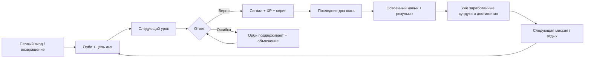

## Что почувствует ученик

- Орби встречает, поддерживает и радуется по событиям. В состоянии покоя нет автоматического покачивания. При отключённых реакциях или reduced motion сохраняются статичные эмоции и читаемый результат.
- После ответа рядом с кнопкой появляется Орби и короткий сигнал. Выбор ответа и правильность имеют разные значки; неверный ответ отмечается тёплым янтарным цветом, не зелёной галочкой. Объяснение ошибки прокручивается в поле зрения.
- Каждые три верных ответа — короткий музыкальный мотив серии. Последние два шага урока получают спокойное текстовое предвкушение финала.
- Результат показывает фактические XP именно этой сессии, цель дня, новые сундуки, достижения и освоенный навык. «Следующая миссия», «Открыть находки» и «На сегодня достаточно» образуют понятный выбор.
- Повторное открытие результата не раздаёт награды и не повторяет фанфары. Ключ показа завершения привязан к ID сессии; начисления по-прежнему делает существующий журнал событий и reconciler.
- Задание на пять слов честно закрыто, пока не изучено достаточно слов или не пришло время повторения по SM-2. Кнопка ведёт к доступному уроку. Новая quest-экономика не создавалась, старые grant ID сохранены.

## Визуальный и звуковой язык

Небольшая библиотека `FlightTokens`, `FlightPanel`, `FlightProgress`, `FlightArrival`, `AnswerSignal` используется в ежедневном маршруте, обратной связи и завершении. Основы: светлая бумага / ночной синий, бирюзовый сигнал, ровные поверхности, тонкая граница, радиус 20, короткие направленные переходы. Убраны тяжёлый фон на каждом экране, лишние баннеры и выдавленные тени вариантов ответа. Готовые персонажи и логотип KVESMOS сохранены; новой генерации графики нет.

Восемь собственных коротких звуков пересинтезированы из одной нотной палитры. Мягкие атака/затухание, более тихие касание и ошибка, защита сигнала награды от частых касаний. Один владелец звука отменяет речь перед эффектом; нативный плеер не накладывает эффекты друг на друга. Речь, эффекты, громкость и реакции остаются отдельными настройками. Системный беззвучный режим Android учитывается для эффектов.

Звуки созданы алгоритмом `tool/prepare_learning_sounds.py`, без скачанных семплов; права третьих лиц не добавлены. PCM mono 22 050 Hz, пики ниже 0,31 полной шкалы, длительности 0,063–0,612 с. Три офлайн-голоса Kokoro, 94 реплики / 188 файлов остаются без изменения; это не девять актёрских голосов. Оценка комфорта на динамиках и наушниках требует человеческого прослушивания.

## Сравнение с 0.5

Одинаковая заполненная тестовая база: 11 завершённых уроков и начатый двенадцатый. Настоящие Flutter-виджеты, 390 × 844 логических px. Файлы 0.5 сохранены из предыдущего проверенного коммита.

| 0.5: цель ниже большого баннера и карты | 0.6: цель и действия на первом экране |
|---|---|
| 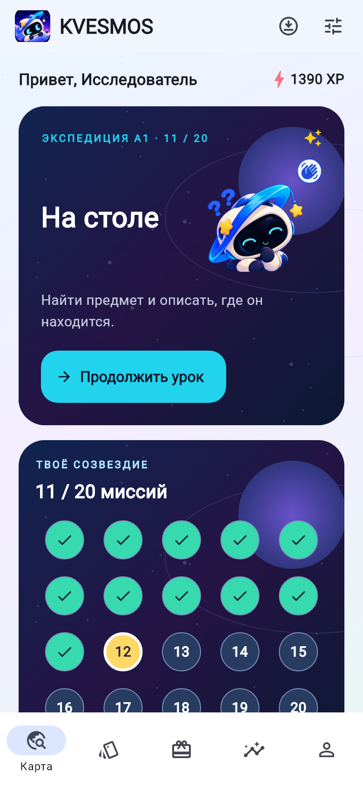 | 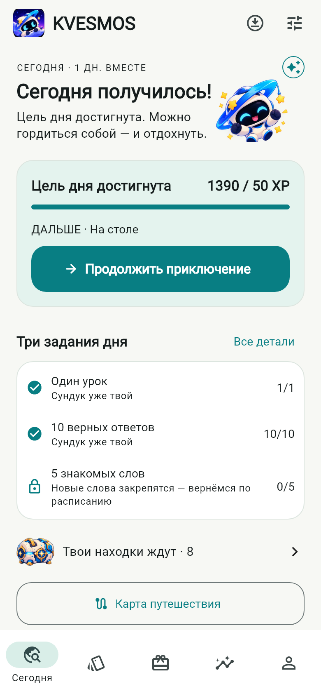 |

| 0.5: длинный экран результата | 0.6: результат, находка, следующий шаг |
|---|---|
| 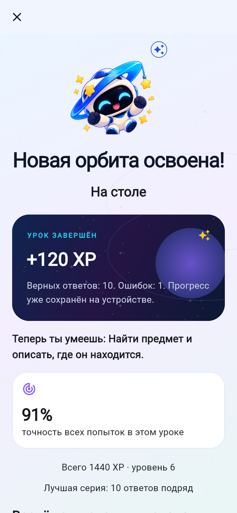 | 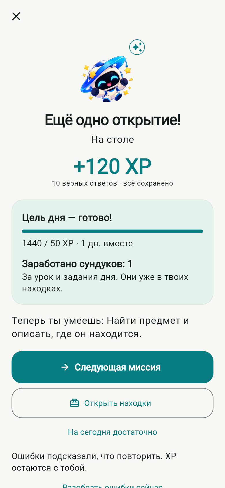 |

## Состояния и обратная связь

| Первый полёт | Возвращение после паузы |
|---|---|
| 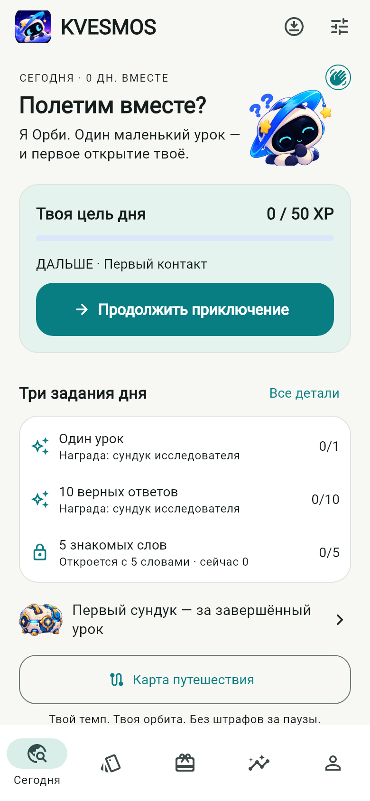 | 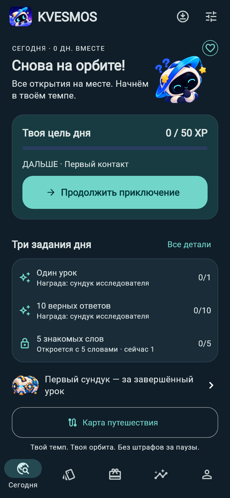 |

| В процессе | Цель достигнута |
|---|---|
| 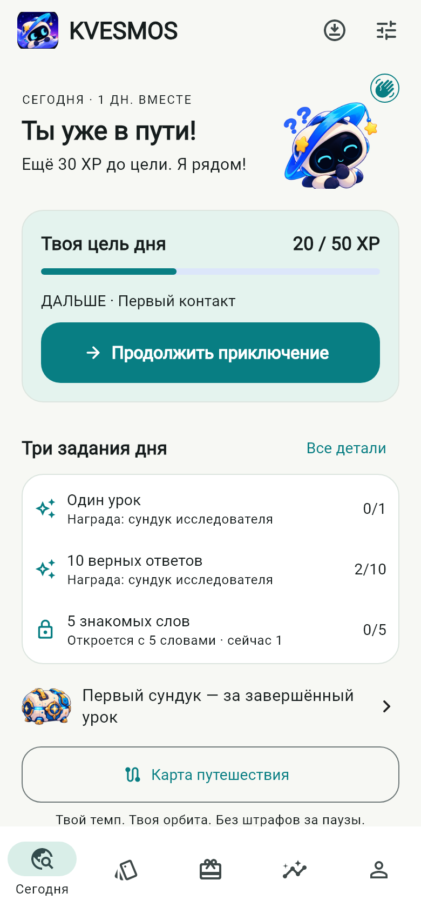 | 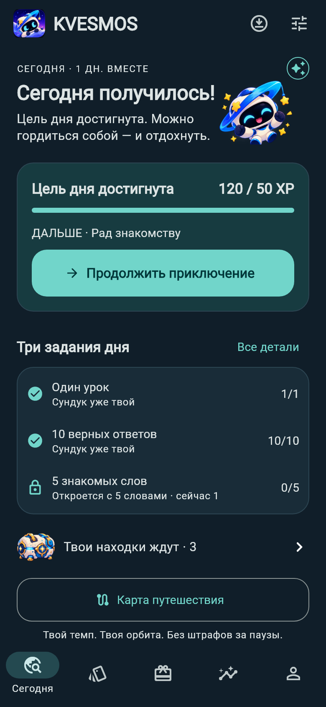 |

| Верный ответ | Поддержка после ошибки |
|---|---|
| 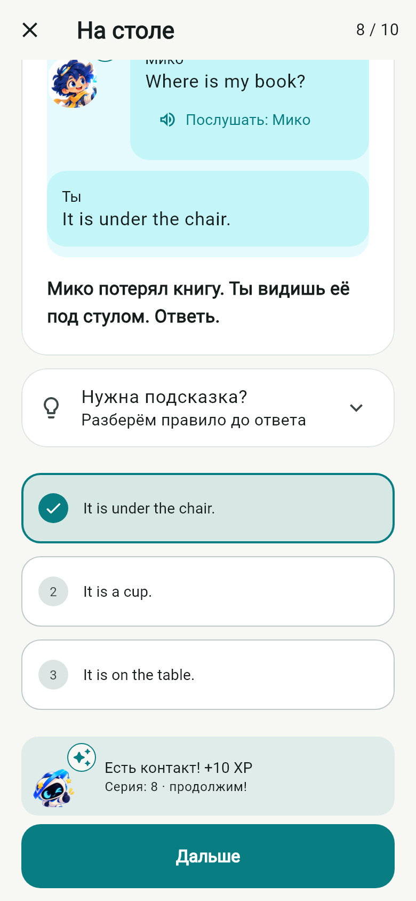 | 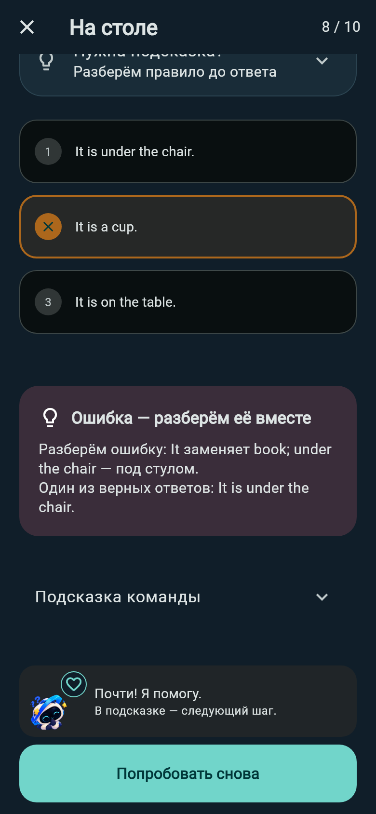 |

| Задания дня | Открытая награда |
|---|---|
| 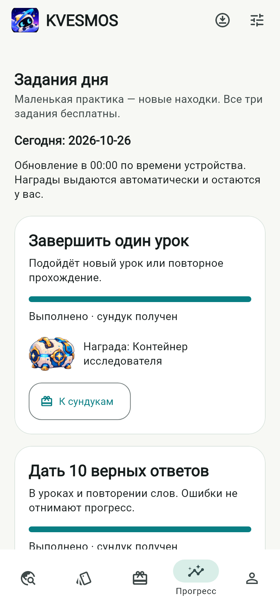 | 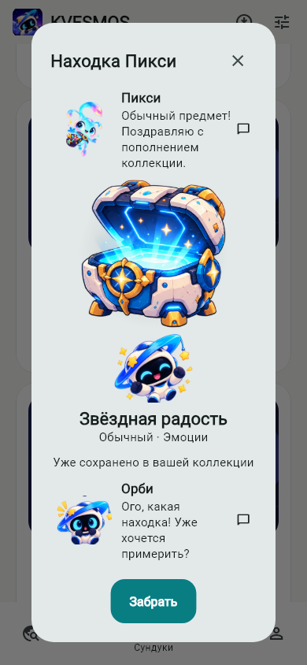 |

Снимки шириной 320 px при масштабе текста 200% имеют суффикс `-320-200`. На таком масштабе страницы прокручиваются: Орби переносится над приветствием, XP-цель размещается вертикально, второстепенная строка обратной связи убирается. Масштаб текста не ограничивается.

## Демонстрация

[38,9 секунды настоящего цикла Flutter](screenshots/v06/alive-journey.mp4): четыре шага знакомства → обучение → ошибка и исправление → десять заданий → 120 XP → три существующие награды → открытие сундука. Это запись рендеринга производственных виджетов, 390 × 844, 10 кадров/с, с изолированной базой. Без звука и системной клавиатуры; это не запись с физического телефона. Воспроизводится через `CAPTURE_DEMO=1 flutter test test/alive_demo_test.dart`; кадры сохраняются в `test-output/v06/frames`.

## Проверка и ограничения

Локально: **102 теста прошли**, один необязательный тест видеозаписи пропущен в общем прогоне и отдельно успешно выполнен с `CAPTURE_DEMO=1`. Анализатор — без замечаний. Сборка Android x64 успешна. Финальные GitHub Actions и ARM64 APK доступны в связанном Draft PR.

Сценарии тестов: четыре состояния главной в обеих темах при 390 px и 320 px / 200%, достижимость кнопки без прокрутки, повторный вход, конкурирующие запросы показа, смена даты и возвращение к прежней дате, SM-2, награды без дублей, все 20 уроков через интерфейс. Существующие проверки офлайн, синхронизации, черновиков, повторного прохождения, календаря, уведомлений и инвентаря сохранены.

Обновление заполненного Android API 36 QA-эмулятора с 0.5 до 0.6 сохранило все старые строки: 8 настроек, 20 пакетов уроков, 3 сессии, 13 событий. Добавлена отметка приветствия; схема 1 не менялась. После нативного теста основная сборка и резервная копия QA-профиля восстановлены, сравнение строк повторно прошло. [Снимок Android после обновления](screenshots/v06/android-upgraded-home.png). Android package `dev.orbitwords.orbitwords`, iOS bundle ID, XP, SM-2, инвентарь и закреплённые материалы начатых уроков сохранены. SHA-256 сертификата: `b8c558730dd20651119dd74b014b31ff51f076af208198dc79e05e51a0dca8be`.

**Нативный сценарий Android API 36 прошёл за 1 мин 26 с**: первый вход, все десять заданий первого урока, ошибка и исправление, 120 XP, три сундука, открытие награды, повторное обновление без дублей. Первые попытки прерывались вместе с процессом эмулятора; запуск эмулятора отдельным процессом позволил завершить проверку.

Нативный демонстрационный тест использует изолированную базу в памяти и те же производственные экраны. Flutter integration runner запускается только на выделенном QA-эмуляторе: он может переустановить тестовое приложение. До запуска создаётся резервная копия, после возвращаются основная сборка и тестовые данные. Телефон пользователя не подключался и не очищался.

Остаются физический Android, сборка iOS, полный ручной TalkBack/VoiceOver-аудит и человеческое прослушивание. Полного скелетного рига и фонемной синхронизации губ нет. Это проверочная версия, а не публикация в магазинах.
