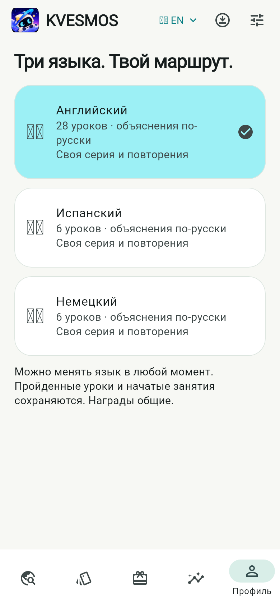
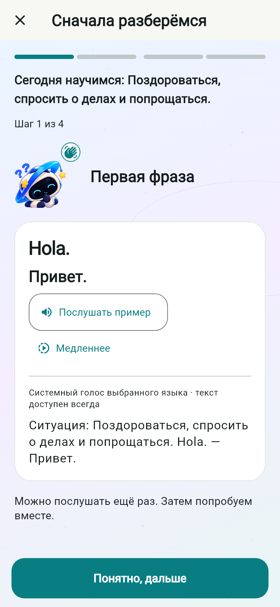
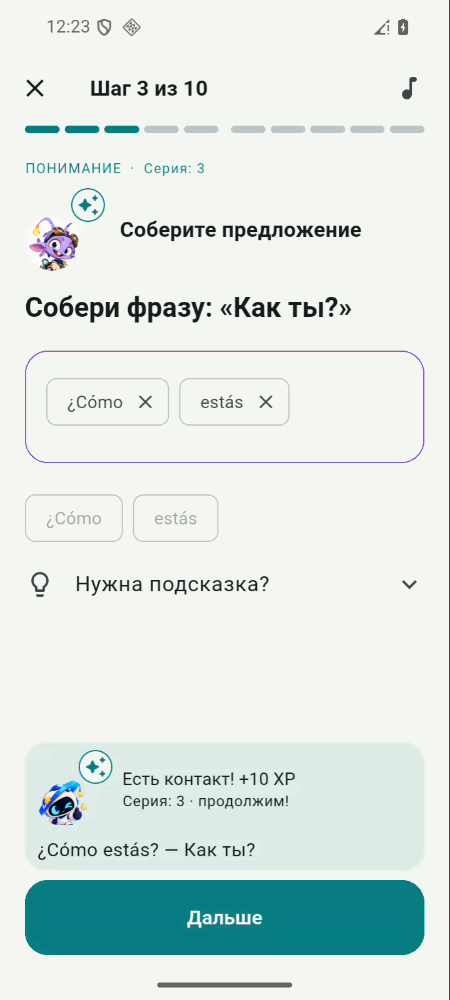
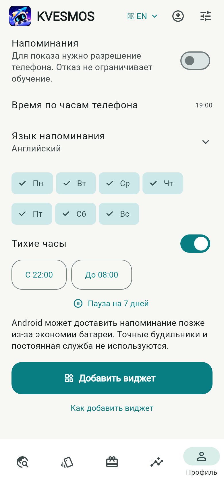

# KVESMOS 0.11 — Languages & Daily Companion

Задание: [Issue #13](https://github.com/1anchay/KVESMOS/issues/13). База: `codex/kvesmos-v010-learning-first`, `ea30b27f9bda0807accbb67ce99d158cd3235290`. Рабочая ветка: `codex/kvesmos-v011-languages-companion`. Версия `0.11.0-dev.1+13`. В main изменения не объединяются.

## Учебные маршруты

| Курс | Стабильный ID | Уроки | Озвучка новых выражений |
|---|---|---:|---|
| Английский | `ru-en` | 28 | `en-US`, прежние встроенные записи сохранены |
| Испанский | `ru-es` | 6 | установленный офлайн-голос `es-ES` |
| Немецкий | `ru-de` | 6 | установленный офлайн-голос `de-DE` |

Объяснения остаются на русском. Выбор курса доступен при первом запуске и в шапке приложения; меняются главная, карта, словарь, повторение, статистика и продолжение занятия. Английский мини-игровой маршрут сохранён в дополнительных возможностях английского курса.

Восемь новых английских тем: время и дни, покупки и цены, транспорт, дом, погода, хобби, здоровье, эмоции. Стартовые испанский и немецкий: приветствия, знакомство, предметы и артикли, числа и возраст, семья, кафе. В каждом новом уроке четыре объясняющие карточки, четыре выражения и десять заданий: выбор значения, сборка фразы, пары, аудиовыбор, пропуск, диалог, исправление, самостоятельный перевод и закрепление. Объяснения учитывают особенности языка; немецкое первое задание на исправление не зависит от регистра, который нормализуется при проверке.

Новый контент хранится в обычных JSON-пакетах. `tool/author_languages_v011.py` воспроизводит только новые материалы и их манифесты. Прежние 20 JSON-пакетов и закреплённые варианты 0.10 не переписываются. Эти вводные маршруты не объявляются полным курсом CEFR A1 и требуют последующей редакторской проверки носителями языка.

Кнопки примеров, медленной речи и реплик диалога используют язык курса. Русские реплики персонажей сохраняют `ru-RU`. Отсутствующий испанский/немецкий голос не заменяется английским: показывается причина и остаётся текстовая альтернатива. Новые голосовые записи не создавались; изображение Орби и остальные ассеты переиспользованы.

## Совместимость данных

- Package ID `dev.orbitwords.orbitwords`, схема SQLite `1`, прежние таблицы и идентификаторы событий не меняются.
- Старые события без `courseId` относятся к английскому. Новые получают `courseId` и `targetLanguage`, определённые по ID урока/слова, а не по случайному текущему выбору интерфейса.
- XP, серия, слова, SM-2, учебная статистика, доступность уроков и сохранённая практика разделены по языкам. Одновременно можно иметь три незавершённых урока.
- Инвентарь, внешний вид, уровень профиля, достижения, три ежедневные миссии и экспедиции общие. Выдача наград использует прежние идентификаторы; переключение курса ничего не начисляет. Профиль показывает отдельно XP курса и всех языков.
- Добавление пакетов идемпотентно: `kvesmos.pack.seen.v1:<id>` отмечает уже обработанный пакет. Удалённые пользователем старые и новые уроки не устанавливаются повторно после перезапуска. Существующие пакеты и материал начатой сессии не заменяются.
- Синхронизация переносит дополнительные поля событий и сохраняет прежнюю дедупликацию. Проверена двумя локальными хранилищами с тестовым удалённым адаптером; работа с реальным Supabase-проектом здесь не заявляется.

Проверка обновления 0.10 → 0.11 через `adb install -r` на выделенном QA-эмуляторе сохранила каждую прежнюю строку: 13 настроек, 20 пакетов, 3 сессии и 13 событий. После добавления курса — 53 настройки и 40 пакетов. База, WAL, настройки и прежний APK сохранены до установки. Личный телефон не используется.

## Орби рядом: напоминания

По умолчанию выключены. Разрешение Android/iOS запрашивается только после включения пользователем. Отказ оставляет обучение доступным. Настраиваются местное время, дни недели, язык, тихие часы (в том числе через полночь), пауза на семь дней и возобновление. Выполненная цель выбранного языка отменяет сегодняшнее напоминание. Выбор языка в приложении не меняет язык напоминания без явного изменения настройки.

Android использует один ближайший `AlarmManager.setAndAllowWhileIdle` и нативный receiver. На доставке повторно проверяются день недели, пауза, тихие часы, выполненная цель, разрешение и сохранённый `lastSent`. Последний запрещает повторную доставку в тот же календарный день, в том числе после смены курса/перезапуска. Receiver перевычисляет следующий подходящий день. `BOOT_COMPLETED`, смена времени/часового пояса и обновление пакета восстанавливают расписание без Flutter. Нет exact-alarm permission, foreground service, сервера или периодического фонового опроса.

Почему Android не использует периодический показ плагина: такой показ не умеет проверить свежую дневную цель и ограничения непосредственно перед доставкой без работающего Flutter. Плагин сохранён для разрешений и iOS, прежнее неподконтрольное периодическое уведомление ID 1 отменяется. Напоминание содержит короткое приглашение без вымышленных чисел повторения. Cold/warm tap передаёт стабильный course ID; приложение выбирает курс и продолжает доступный урок/черновик.

Android может задерживать неточный сигнал при Doze. После ручного force-stop система не обязана доставлять сигналы до следующего открытия приложения. Ограничения конкретных OEM и многодневная работа на физическом телефоне требуют отдельного испытания.

На iOS подготовлено локальное планирование `zonedSchedule` на 14 дней, с часовым поясом устройства через Swift-канал и пересчётом при открытии/изменениях. Это ограниченный горизонт, а не бесконечное фоновое расписание. iOS не собирался и не испытывался на этой Windows-машине; паритет поведения Android/iOS не заявляется.

## Домашний виджет Android

`StreakWidget` — настоящий `AppWidgetProvider`/`RemoteViews`, а не изображение в приложении. Он показывает Орби, флаг и название выбранного языка, серию, сегодняшние XP/цель, полосу и кнопку продолжения. Система подтверждает добавление. Есть инструкция для ручного добавления через лаунчер. Размер изменяется средствами лаунчера; формат от 2 × 2, увеличенный шрифт серии для широкой области.

Flutter передаёт версионированную read-only проекцию журнала: `version`, `selectedCourse`, `goal`, `updatedAt`, `courses[id].{name,flag,dailyXp}`, `reminders`. SharedPreferences `kvesmos_companion_v1` не являются вторым источником XP. Виджет вычисляет сегодняшнюю цель и серию по календарю устройства, обновляется после занятий и смены курса, системного обновления, смены даты/времени/часового пояса и перезагрузки. Нет записей в учебный журнал или выдачи наград из виджета.

Для WidgetKit оставлен общий контракт snapshot и Swift-adapter. Следующий шаг на macOS: отдельный Widget Extension, согласованный App Group и перенос snapshot из стандартного UserDefaults в его suite, TimelineProvider с записью на следующую полночь, AppIntent/deep link курса и проверка entitlements/signing. Сейчас extension, App Group и виджет iOS не поставляются; интерфейс честно об этом сообщает.

## Проверки и демонстрация

- Полный локальный набор до завершающих адресных правок: 148 passed, 2 optional demo skipped. Проверены все 40 уроков через реальные элементы Flutter UI, 4800 XP за их прохождение на уровне хранилища, сохранность старого черновика, удаление пакета, разделение практики и повторная синхронизация.
- Дополнительные адресные тесты: голоса обоих новых языков, отсутствие английской подмены, язык кнопок диалога, прежний профиль и общий прогресс достижений — 17 passed.
- Четыре визуальных сценария: светлая/тёмная темы, 390 dp и 320 dp с текстом 200%. Проверяются главная, карта, объяснение/упражнение трёх языков, выбор курса и настройки спутника. На 200% длинные элементы прокручиваются; язык напоминания выбирается в отдельном списке без обрезания названия.
- Скриншоты Flutter сохраняются в `test-output/v011` при `CAPTURE_UI=1`. Тестовый Windows-рендерер не содержит цветной emoji-шрифт: флаги на этих снимках могут выглядеть как отсутствующий глиф. Нативные снимки Android показывают фактический результат.
- Нативный тест: `flutter test --no-uninstall integration_test/languages_companion_test.dart -d <QA-emulator-id>`. Перед ним запустить `python tool/qa_languages_companion.py --sdk <SDK> --serial <QA-emulator-id>` для системного подтверждения виджета и записи демонстрации. Использует отдельную БД в памяти, реальные Android audio/widget adapters, проходит по одному полному уроку каждого языка и проверяет 120 XP/курс, 360 общих XP и отсутствие повторных наград. Запускать только после резервного копирования на выделенном эмуляторе; затем вернуть обычный `lib/main.dart` APK и исходные тестовые данные.

Нативный офлайн-проход API 36 завершён за 4:19: [журнал](verification/v011/native-courses.log), [видео испанского урока](screenshots/v011/native-spanish-cycle.mp4). Три курса получили независимые 120 XP, смена языка не дублирует награды. В эмуляторе отсутствуют испанский и немецкий офлайн-голоса; проверен честный текстовый fallback, а наличие и выбор соответствующих голосов дополнительно проверены подменным TTS-адаптером.

Виджет проверен после завершения уроков и обновления обычного APK: [2×2](screenshots/v011/native-widget-2x2.png), [4×2](screenshots/v011/native-widget-4x2.png). Вариант 2×2 уплотнён после визуальной проверки, чтобы кнопка помещалась целиком. В видео урока ещё видна прежняя более тесная компоновка; отдельные снимки показывают окончательную. Смена часового пояса через границу дня без открытого Flutter сбрасывает дневные XP, сохраняя вчерашнюю серию; перенос через пропущенный день обнуляет серию: [результаты](verification/v011/widget-calendar.json), [снимок следующего дня](screenshots/v011/native-widget-next-day.png). Системные дата, время и автоматические настройки после проверки восстановлены.

Обычная сборка повторно прошла проверку старой базы: [сравнение строк](verification/v011/data-preservation.json), [главная после обновления](screenshots/v011/native-home-upgrade.png). Во время QA два запуска были прерваны аварией самого QEMU/SwiftShader в Windows (0xc0000005); проверка завершилась на SwANGLE с отключённым Vulkan. Это настройка QA, не изменение продукта; [рекомендации Android по диагностике эмулятора](https://developer.android.com/studio/run/emulator-troubleshooting).

Настоящее уведомление доставлено по установленному пользователем времени без сети и с завершённым процессом приложения: [уведомление](screenshots/v011/native-notification.png), [видео перехода](screenshots/v011/native-notification-cycle.mp4). Нажатие выбирает испанский и открывает его занятие; [результат холодного запуска](screenshots/v011/native-notification-open.png). `lastSent` сохраняется, ближайший сигнал переносится на следующий день и восстанавливается после перезагрузки эмулятора. Дополнительно проверены cold/warm intents разных курсов; подтверждение обработки Dart предотвращает преждевременное удаление extra при раннем `onNewIntent`. Два теста маршрутизации покрывают ожидающий переход до онбординга и смену курса в работающем приложении.

Первый прогон CI обнаружил переполнение шапки на Linux при тексте 200%. На узком экране/крупном шрифте переключатель теперь показывает код языка с системной иконкой; полное название остаётся в accessibility label. Адресные проверки всех страниц и языковых экранов после исправления прошли: 6 тестов, analyze без замечаний.

| Экран | Результат |
|---|---|
| Выбор курса |  |
| Объяснение на испанском |  |
| Реальный урок Android |  |
| Настройки напоминаний |  |

Новые возможности Android и интеграция курсов не являются заявлением о проверке на физическом ARM64 или iPhone. Полноценная слышимость TTS требует установленных офлайн-голосов и устройства со звуком. Запись экрана эмулятора не содержит аудио.
