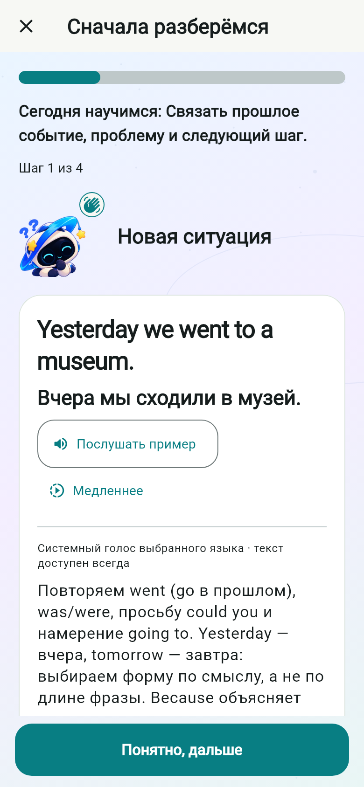
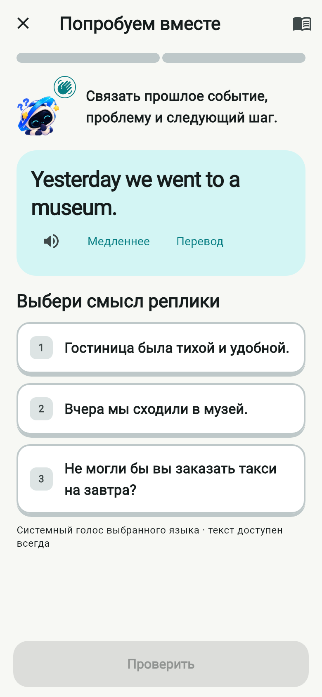
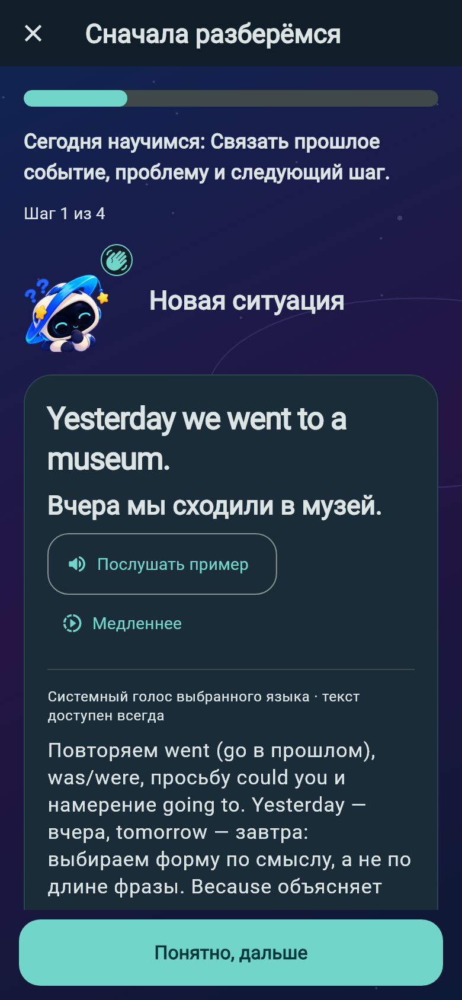
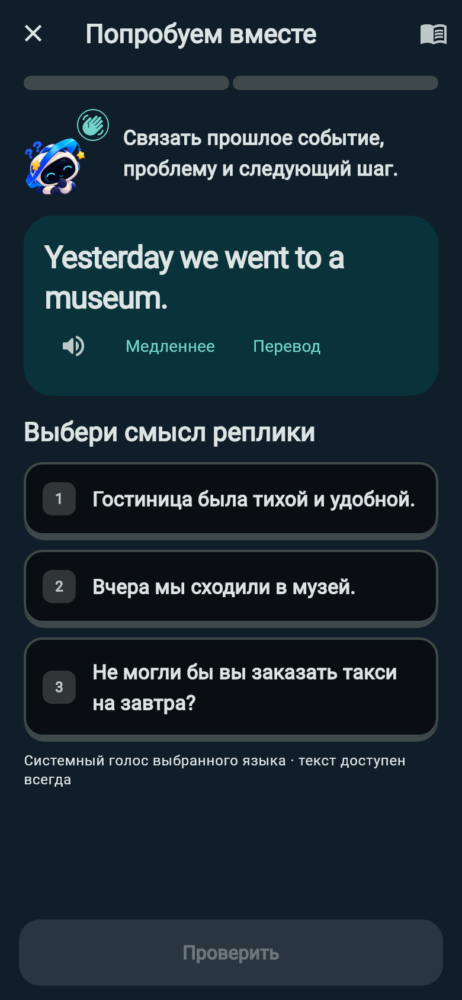

# KVESMOS 0.14 — Learning Experience

Рабочая версия `0.14.0-dev.1+16`, база `ee2a2a0b0a9164e0a6457da2a3e922934c90fe8e` / PR #18. Ветка `codex/kvesmos-v014-learning-experience`. Это проверочный кандидат, не разрешение на публикацию 1.0.

## Изменения

- Два настоящих действия введения: узнавание смысла, затем сборка реплики. Фраза, пиньинь, нормальная/медленная озвучка и раскрываемый перевод доступны сразу. После ответа — короткое объяснение; полного чтения теории перед заданиями нет.
- Неизменённые старые `teachingSteps` преобразуются в действия при чтении. Новые занятия используют `introActivities`. Выбор, составленные слова, подсказка, ошибка, успех и текущий пример сохраняются отдельно от основного черновика. Введение не создаёт событий ответа и не выдаёт XP.
- Повтор пройденного занятия сразу открывает упражнения. Справочник доступен из каждого задания, из него можно снова попробовать введение с Орби. Начатые сессии используют прежние закреплённые материалы.
- 160 занятий: EN60, ES30, DE30, FR20, ZH20. 60 новых сценариев, 510 новых упражнений, всего 1 510. Прежние 100 пакетов и 20 обновлённых вводных материалов побайтово эквивалентны базе с учётом Git EOL. Подробности: [программа](CURRICULUM-0.14.md), [машинный аудит](curriculum-v014-audit.json).
- Сегментированный прогресс, короткие переходы и существующие реакции/звуки; новые мини-игры, валюта и повторные награды не добавлялись.
- Расширены штатные лицензированные английские, испанские, немецкие и французские записи. Китайский сохраняет системный голос и читаемую альтернативу; модель с неизвестной лицензией не включена. Шрифт расширен до 276 необходимых символов.

## Проверки и ограничения

Полный локальный прогон: **338 passed, 2 прежних необязательных skipped**, 11:19. Все 160 уроков пройдены через Flutter UI. Анализатор: без замечаний; форматирование проверено. Android API36 x64: полный сценарий пяти новых уроков, ошибка/перевод/возобновление введения, 6 практик, профиль, коллекции, повторное открытие сундука, оба оформления и виджеты — **passed, 11:36**. 24 визуальных конфигурации: обе темы, 390 dp и 320 dp / 200%. 1 618 AAC проверены по SHA-256 и декодированы; [отчёт о голосах](audio/VOICES-0.14.md).

При обновлении реальной установленной QA-базы 0.13 → 0.14: **0 изменённых/потерянных прежних строк**, события 13→13, сессии 4→4, настройки 118→179, пакеты 100→160. SQLite schema v1 и package ID прежние. Подробности: [сравнение базы](screenshots/v014/upgrade-preservation.json). Личные данные остаются только в приватной локальной резервной копии.

Код `e9154379b81c492f076081099c7350f11411fe9a` прошёл [Quality PR](https://github.com/1anchay/KVESMOS/actions/runs/42283691079), [Quality push](https://github.com/1anchay/KVESMOS/actions/runs/42283505196) и [Android Preview](https://github.com/1anchay/KVESMOS/actions/runs/42283505113). Проверочный ARM64 APK: 145 382 128 байт (+14 402 209 к 0.13); SHA-256 `20d29ca217656581271db0ea4693b784e996357345ad40221d64c98b1968ae63`. Сертификат `b8c558730dd20651119dd74b014b31ff51f076af208198dc79e05e51a0dca8be`, package `dev.orbitwords.orbitwords`, versionCode 16. 1 203 прежних неизменяемых ассета совпадают побайтово, тестовый сценарий отсутствует. [Артефакт сборки](https://github.com/1anchay/KVESMOS/actions/runs/42283505113/artifacts/13536914899).

### Демонстрация

[Английский цикл — 1:44](screenshots/v014/lesson-cycle-en.mp4) · [Китайский цикл — 1:49](screenshots/v014/lesson-cycle-zh.mp4) · [Сундук](screenshots/v014/chest-cycle.mp4). Видео сняты Android screenrecord, без звуковой дорожки; не являются доказательством прослушивания.

| До 0.13: обязательное чтение | После 0.14: действие сразу |
|---|---|
|  |  |
|  |  |

Baseline введения отрисован реальным Flutter-виджетом из проверенного коммита 0.13. Новые снимки — Flutter UI и Android, без макетов. Первое мини-задание доступно сразу, обязательных переходов теории перед ним — 0 (ранее требовалось пройти последовательность teachingSteps). Обычный урок: [0.13](screenshots/v013/native-lesson-en.png) / [0.14](screenshots/v014/lesson-en.png).

Физического Android-устройства и среды iOS в этой сессии нет. Декодирование аудио и проверка языка/источника не заменяют прослушивание носителями. Все эти пункты остаются обязательными до 1.0.

## Что мешает публикации 1.0

1. Проверка на физическом Android: реальная слышимость, громкость, конкуренция TTS и эффектов, слабое устройство, системные голоса, TalkBack, батарея и доставка уведомлений в фоне.
2. Редактура пяти программ носителями и прослушивание новых синтетических записей; китайский офлайн-голос — только после подтверждения лицензии и качества.
3. Подтверждённый production signing и резервное хранение ключа, Play App Signing и процедуры обновления. Не подменять постоянный сертификат новым. `android/key.properties` читается только сборкой; приложение не подписывается случайным release-ключом.
4. Финальная сверка [политики приватности](PRIVACY.md), Data Safety, разрешений микрофона и уведомлений, сведений об офлайн-режиме и облачной синхронизации, лицензий и материалов магазина.
5. Release/AAB и реальные измерения запуска/памяти. Debug-APK и эмулятор не подтверждают характеристики production.
6. iOS: macOS/Xcode, signing, реальные устройства, микрофон/TTS/уведомления и отдельные материалы App Store.

## Безопасная интеграция цепочки PR

Автоматически ничего не объединять. С согласия владельца сначала проверить и отметить исходные SHA всех зависимых PR #1–#18, сохранить теги проверенных кандидатов и резервные APK/ключи. Рассматривать изменения от самого раннего предка к потомкам; после каждого merge обновлять базу следующего PR и проверять, что diff содержит только его этап. Перед 0.14 объединить и проверить 0.13. Альтернатива по отдельному решению владельца — единый интеграционный PR от конечной ветки к main с полным diff, лицензиями и проверкой обновления от последней реально распространённой версии; старые Draft PR закрыть только после сверки достижимости всех коммитов. Независимо от стратегии, финальный SHA должен снова пройти CI и проверку подписи/обновления. В этой работе ветки и PR не объединяются.

Дополнительная проверка установленной сборки: уведомление не доставляется без разрешения и доставляется после временного разрешения; прежнее состояние разрешения и настройки восстановлены. Замеры API36 debug x64: медиана Activity launch 0.13 — 5510 мс, 0.14 — 5940 мс (+430 мс); PSS 357121 → 366196 КБ. Это не первый полезный кадр и не release-бенчмарк. Снимок CPU не дал надёжного значения; CPU-профилирование на физическом устройстве остаётся в плане 1.0. [Измерения](screenshots/v014/performance.json).
