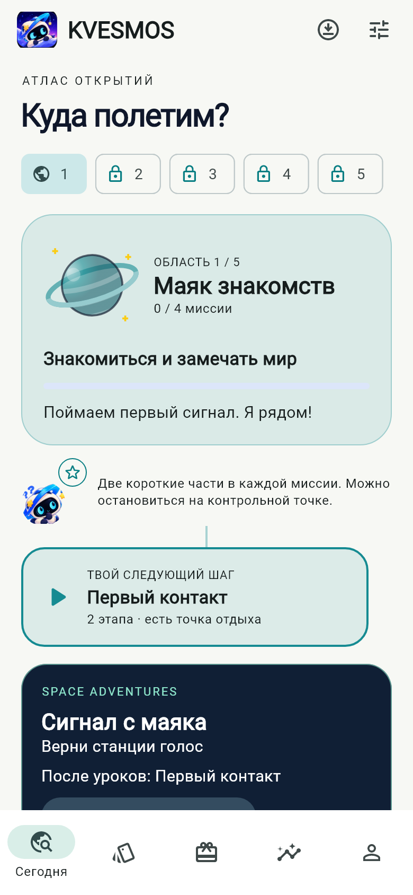
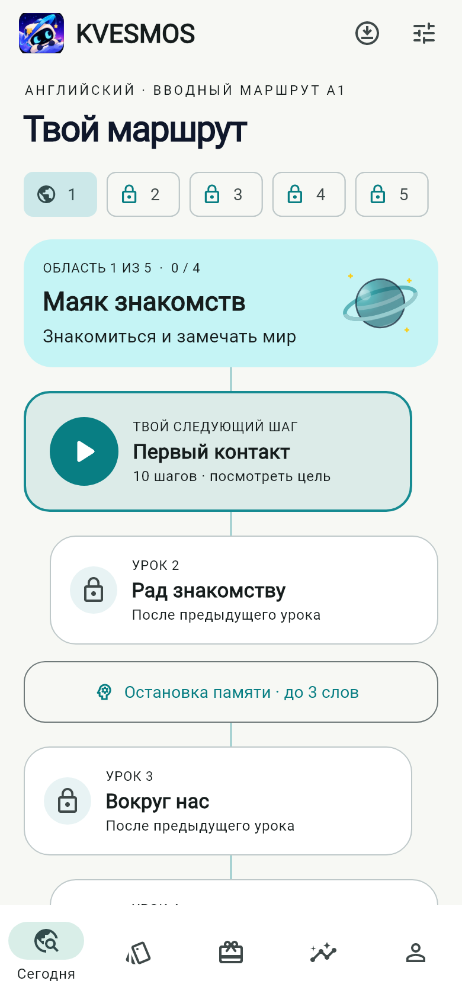
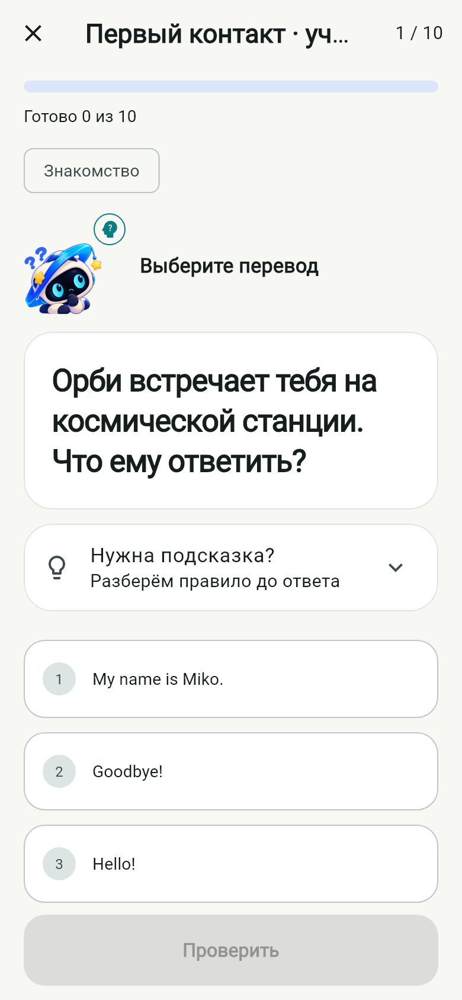
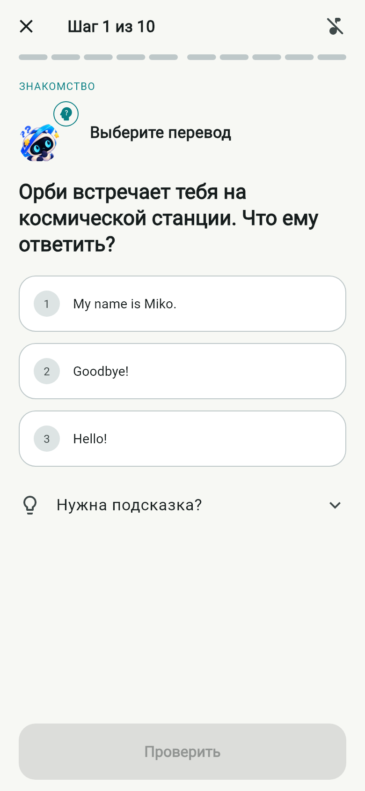
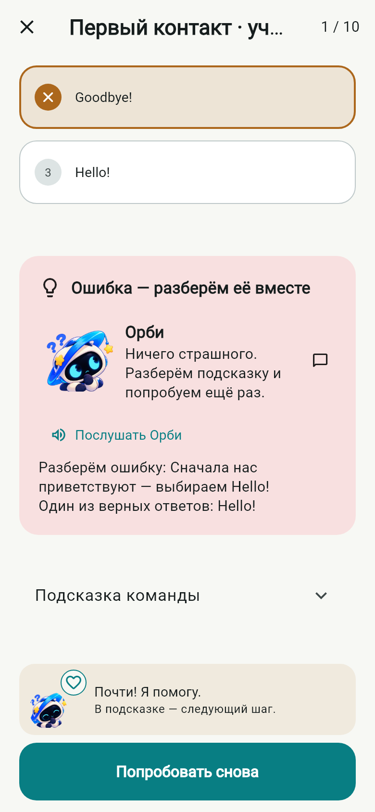
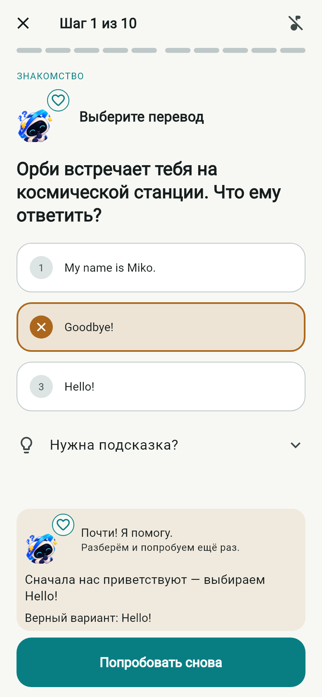
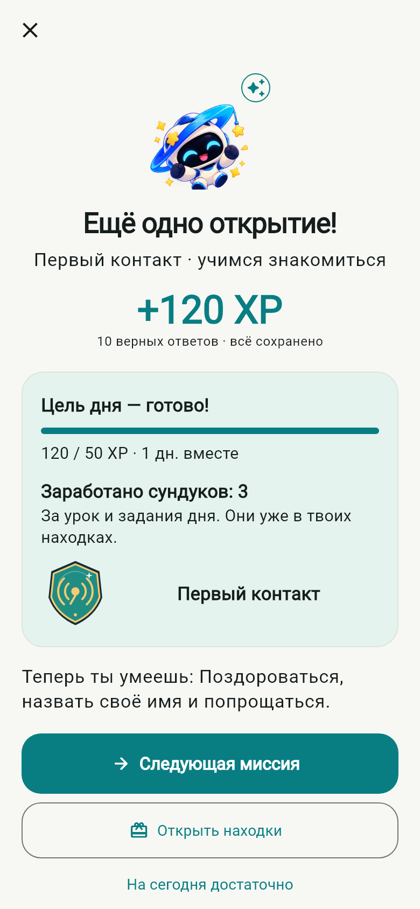
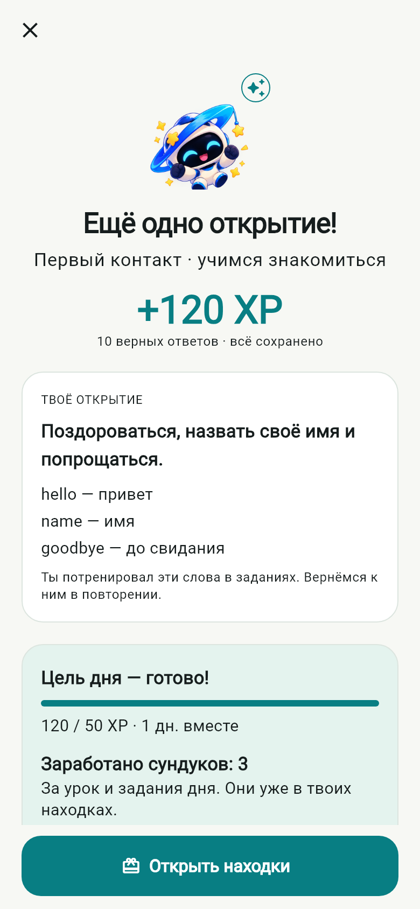

# KVESMOS 0.10 — Learning first

Работа по Issue #11, база `codex/kvesmos-v09-space-adventures`, `fa1441510770b2d10573690ea7b99d26eeb35b57`. Новая ветка: `codex/kvesmos-v010-learning-first`. Версия `0.10.0-dev.1+12`, package ID `dev.orbitwords.orbitwords`. Слияние в main не выполняется.

## Что изменилось

Основной маршрут снова посвящён английскому. Пять областей сохранены, текущий урок выделен большим узлом. Нажатие открывает обзор цели, слов и этапов. Обзор не создаёт сессию: для начатого урока он читает закреплённый материал, включая старый формат.

Три существующих Space Adventures скрыты с карты по умолчанию при новой установке и обновлении. Они доступны через «Дополнительно · Приключения» и настройки. Переключатель сохраняется локально. Каждая карточка и каждый экран игры, включая закрытое и завершённое состояние, имеют кнопку «Пропустить и продолжить уроки». Она останавливает звук и открывает доступный незавершённый обычный урок, следующий урок, офлайн-раздел или карту при завершённом маршруте. Никаких игровых ответов, завершений, наград или XP пропуск не создаёт.

В уроке убраны повторяющиеся большие карточки и дубли объяснений. Сегменты прогресса закреплены сверху, проверка и объяснение ответа — снизу. Подсказка раскрывается по желанию. Ошибка сохраняет возможность исправления без штрафа. Пары показывают выбранные связи; собранную фразу можно исправить удалением слова. Объяснение перед практикой стало компактнее. Переход со средней точки отдыха закреплён и доступен при крупном тексте.

На «Сегодня» видна цель следующего урока. Итог показывает изучавшиеся слова и коммуникативную цель, сохранённый XP и существующие награды. Кнопка открытия заработанных находок всегда доступна. Экономика не менялась.

Выбор ответа больше не обрывает звучащий пример: короткий звук касания пропускается во время речи. Ответ и переход по-прежнему останавливают предыдущую реплику. В заголовке урока добавлен отдельный переключатель эффектов; настройки речи и громкости сохраняются независимо. Офлайн-записи, медленные варианты, текстовый fallback и существующие звуковые эффекты сохранены.

## Реальное сравнение

PNG получены рендерингом настоящих Flutter-экранов с настоящими ассетами и SQLite в памяти, а не макетами. До: код 0.9 указанного коммита. После: реализация 0.10. Обычный размер 390×844, PNG с плотностью 2; также 320×760, текст 200%, обе темы. Первое занятие проходит кнопками, включая ошибку, подсказку, пары и сборку фразы. Первый и третий уроки показаны отдельно.

| Экран | 0.9 | 0.10 |
|---|---|---|
| Карта |  |  |
| Первый вопрос |  |  |
| Ошибка |  |  |
| Завершение |  |  |

Все остальные изображения, включая обзор, подсказку, цель дня, третий урок и 200% текст, находятся в [screenshots/v010](screenshots/v010).

[Полный учебный цикл на Android](screenshots/v010/lesson.mp4) и [пропуск, скрытие и возврат приключения](screenshots/v010/skip.mp4) записаны непосредственно `adb screenrecord` на QA-эмуляторе. Это реальные нажатия в приложении. Записи без звуковой дорожки: этот способ захвата не записывает внутренний звук. В том же сценарии отдельно проверен запуск обычной и медленной локальной записи через нативный аудиобэкенд при отключённых Wi-Fi и мобильной сети.

## Совместимость и проверки

- Схема SQLite остаётся версии 1. Идентификаторы уроков, предметов, событий, сессий и Android-приложения не изменены.
- Ни один исходный файл в `assets/` не изменён. Новых изображений, звуков, уроков, зависимостей или игровой экономики нет.
- Проверены все 20 уроков через UI при выключенной озвучке, а также 200 ответов на уровне хранилища. Сохраняются 2400 XP за весь маршрут.
- Адресные проверки: пропуск всех трёх начатых и завершённых игр из карточек и из самих игр, отсутствие новых событий/XP/наград, продолжение черновика, закрытые/устаревшие сессии, отсутствие офлайн-пакета, завершённый маршрут, скрытие/возврат и перезапуск контроллера.
- Android QA API 36, x86_64: обновление подписанной версии 0.9 через `install -r`. Для проверки начатой игры отдельно восстановлен прежний APK на выделенном эмуляторе, выполнены реальные действия, затем повторено обновление. После запуска 0.10 все прежние строки совпадают: 13 настроек (включая состояние игры и инвентарь), 20 пакетов, 3 сессии, 13 событий. SQLite/WAL и private files сохранены резервной копией. Личный телефон не используется.
- Локально: format и analyze без замечаний; полный набор — 139 passed, 2 optional demo skipped. Нативный цикл — passed, 2:10. После последней правки разделителей текста повторно пройдены четыре визуальных сценария; полный выпуск дополнительно проверяется CI.
- FrameTiming за учебный цикл и награду: 767 кадров; build median 3.802 ms / p95 59.358 ms, raster median 3.311 ms / p95 17.175 ms. Режим debug, x64 API 36, программная среда с записью видео; одновременно на хосте выполнялись тесты. Это не обещание 60 FPS на телефоне и не сопоставимый бенчмарк с 0.9. Задержки первых кадров остаются предметом проверки на физическом устройстве в profile/release.

## Границы результата

Обновлены подача и взаимодействие, а не объём курса. Полноценный курс всех уровней, новая графика и новые приключения сюда не входят. Орби использует существующие состояния изображений и короткие переходы по событиям; это не новая скелетная анимация.

При тексте 200% длинные задания и объяснения прокручиваются; кнопки остаются доступны. Мини-приключения сохраняют оформление 0.9 и остаются дополнительными. Нативная проверка проводится на debug-эмуляторе, а не на физическом ARM64-устройстве; iOS на Windows не собирался. Системный TTS зависит от установленных голосов, поэтому сохранены офлайн-записи и текстовые варианты. Предупреждение Flutter о будущей миграции Kotlin-плагина `flutter_tts` остаётся; версии зависимостей в этом пакете не менялись.

## Принципы обучения

Использованы общие принципы: сначала объяснение, затем поддержанная практика и самостоятельное применение; понятный следующий шаг; распределённое повторение. Контент, персонажи и оформление KVESMOS собственные. Справочные материалы: [teaching method](https://blog.duolingo.com/duolingo-teaching-method/), [learning path](https://blog.duolingo.com/new-duolingo-home-screen-design/), [spaced repetition](https://blog.duolingo.com/spaced-repetition-for-learning/), [practice](https://blog.duolingo.com/ways-to-practice-in-duolingo/).
