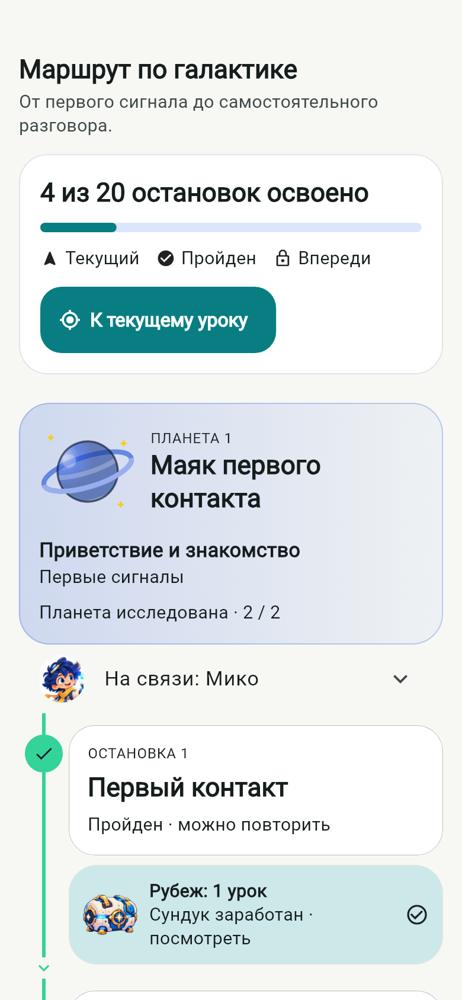
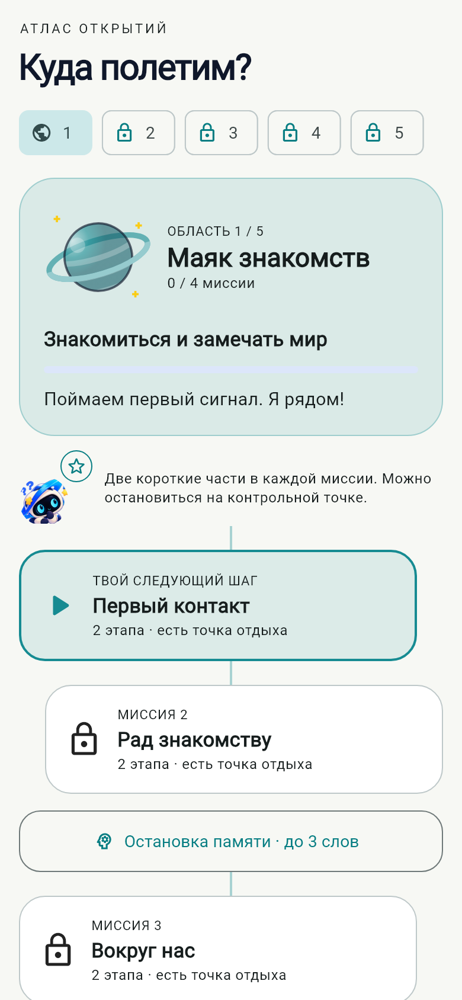
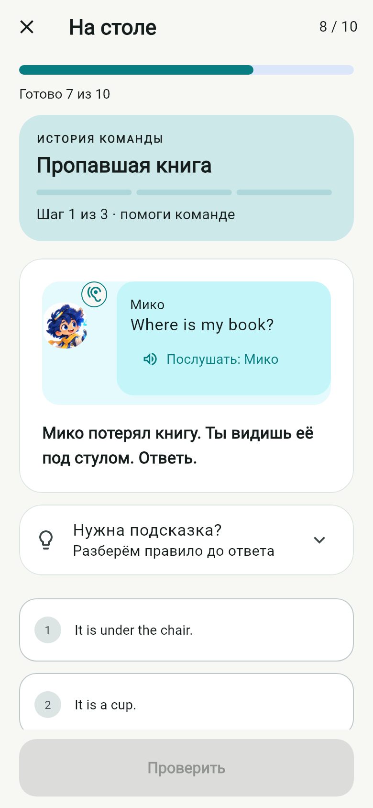
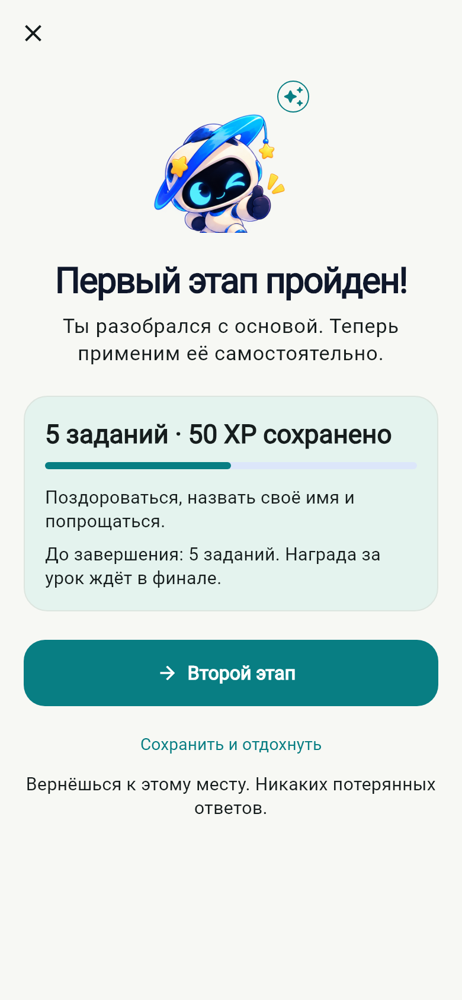
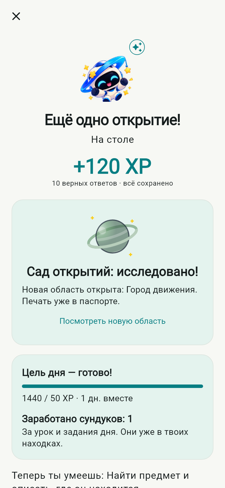
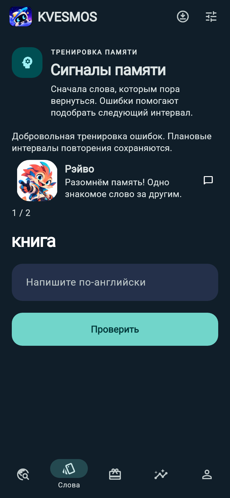
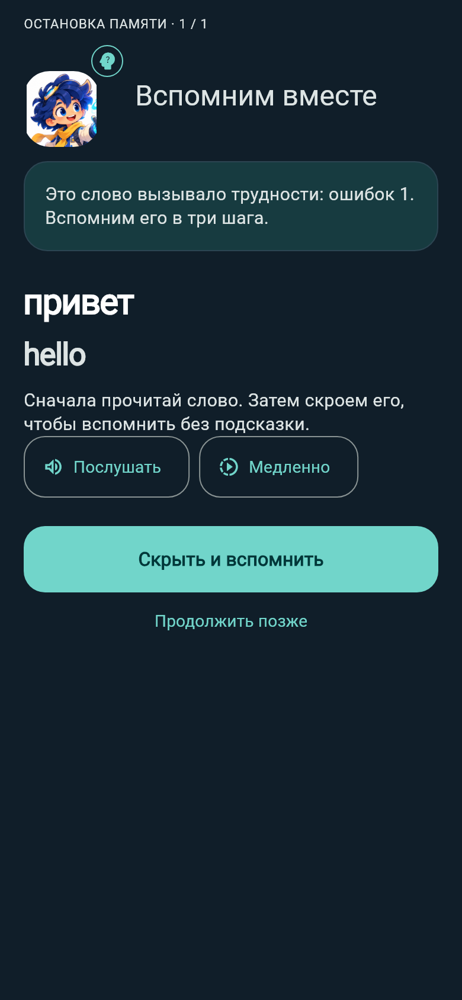
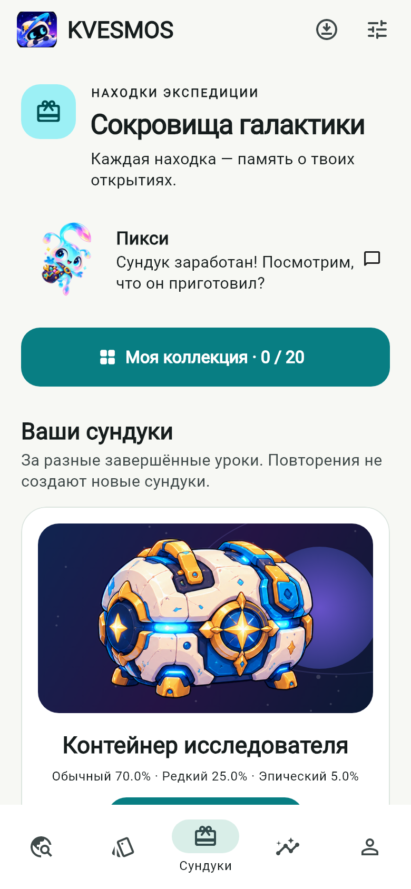
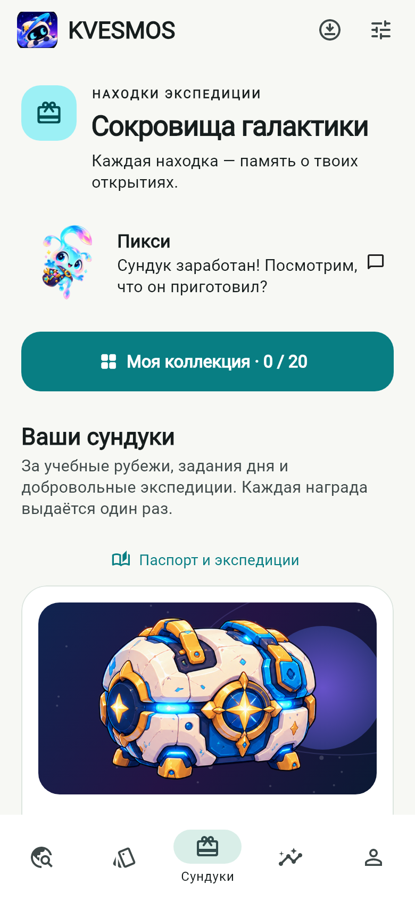

# KVESMOS 0.7 — Учебное путешествие

Проверочная версия **0.7.0-dev.1+9**, ветка `feature/kvesmos-v07-learning-game`, база `a5b4614` / Draft PR #4. Изменения предназначены для отдельного Draft PR в `codex/kvesmos-v06-alive`. Main не изменяется.

## Что изменилось в игре

Теперь 20 существующих миссий образуют пять областей по четыре урока: Маяк знакомств, Обитаемые кольца, Сад открытий, Город движения и Порт разговоров. Карта показывает текущую область, ближайшую миссию, доступные остановки памяти и будущие области для знакомства. Завершение четырёх миссий открывает следующую область и печать в паспорте. Печати вычисляются из настоящих завершений, их нельзя потерять из-за пропущенного показа анимации.

Каждая миссия состоит из двух частей по пять заданий. Контрольная точка показывает сохранённые XP, учебную цель и выбор: продолжить или отдохнуть. Это представление поверх прежней сессии: ID уроков, упражнений и сессий не меняются. За половину урока не выдаётся дополнительный сундук. На главной сохранены цель дня, серия, три ежедневных задания и кнопка продолжения.

Остановка памяти выбирает до трёх слов из существующего SM-2: сначала слова с незакреплёнными ошибками, затем подошедшие по сроку. Причина выбора видна ученику. Последовательность: вспомнить слово с Мико → скрыть подсказку → написать самостоятельно → разобрать ошибку и повторить. Очередь, этап и проверенный ответ сохраняются. Практика использует прежний журнал событий и обновляет прежнее расписание. За успешное повторение одного слова начисляется не более 10 XP в календарный день, в том числе после возврата со старой версии. Исторические XP не пересчитываются и не отнимаются.

Паспорт предлагает добровольные экспедиции: три учебных дня недели и восемь разных завершённых уроков месяца. Они выключены по умолчанию, учитывают уже выполненную работу текущего периода и не включают уведомления. Награды записываются в существующий инвентарь с устойчивыми ID. Повторный вход, конкурентные запросы, смена месяца и закрытие приложения перед выдачей не создают дубликатов. Участие можно выключить; уже полученные предметы сохраняются.

Добавлены три истории — «Гость у маяка», «Проверка координат», «Встреча в кафе» — к пяти существующим. Во всех восьми герой по-разному отвечает на самостоятельный успех, ошибку и успех после подсказки. Это короткие реакции на результат выбора, а не разветвлённая сюжетная RPG. Начатые истории продолжают использовать закреплённый материал своей сессии. Орби, Мико и Зиг получили разные конечные траектории жестов; фонового бесконечного качания нет. Отключение реакций и системное уменьшение движения учитываются.

## Голоса и материалы

Три прежних лицензированных голоса Kokoro сохранены. Добавлены 16 реплик в обычном и медленном темпе: теперь **110 реплик / 220 файлов**, 4 542 466 байт. Все **188 прежних файлов побайтно идентичны** версии 0.6. Контрольные суммы, декодирование AAC и длительности проверены `tool/verify_voice_pack.py`; новые реплики созданы локально, без платного API. Нормальная/медленная речь, повтор, отмена при выходе, отключение звука и текстовая альтернатива используют прежний аудиосервис. Восемь игровых сигналов 0.6 сохранены.

Новая растровая графика не генерировалась. Использованы утверждённые изображения, типографика и исходный рисуемый кодом планетарный декор. Анимации — переходы поз и процедурные жесты, без заявлений о полноценном скелетном риге или синхронизации губ.

## До и после

Это снимки настоящих Flutter-экранов, а не дизайн-макеты. Состояния подготовлены в изолированных SQLite-базах. Для сопоставимости используются одни шрифты и ширина 390 логических пикселей. Снимки `320-200` показывают 320 px и масштаб текста 200%; прокрутка сохраняется, масштаб шрифта не ограничивается.

| Экран | 0.6 | 0.7 |
|---|---|---|
| Карта |  |  |
| Учебная остановка |  |  |
| Завершение области |  |  |
| Работа над ошибками |  |  |
| Находки |  |  |

Дополнительные экраны: [паспорт](screenshots/v07/passport-light.png), [карта с крупным текстом](screenshots/v07/map-dark-320-200.png), [контрольная точка с крупным текстом](screenshots/v07/checkpoint-dark-320-200.png), [реакция на ответ](screenshots/v07/correct-light.png), [ошибка](screenshots/v07/support-dark.png).

## Демонстрация

[Первый день, 43,1 с](screenshots/v07/day-one.mp4): знакомство → главная → карта → первый урок → ошибка и помощь → контрольная точка → завершение → открытие сундука.

[Возвращение на второй день, 17,4 с](screenshots/v07/day-two.mp4): новая дневная цель → персональная практика → самостоятельное воспроизведение слов → завершение разминки. Только часы тестовой базы переведены на следующий день; системная дата пользователя не меняется.

Видео записаны с производственных Flutter-виджетов в `test/alive_demo_test.dart`, 390 × 844, 10 кадров/с. Это запись рендеринга без звука и системной клавиатуры, не запись с физического телефона. Воспроизведение: `CAPTURE_DEMO=1 flutter test test/alive_demo_test.dart`.

При попытке прямой записи через Android `screenrecord` эмулятор потерял соединение; пригодная нативная видеозапись не получена. Сам нативный сценарий проверяется отдельно без screenrecord, итог указан в Draft PR.

## Проверки и воспроизведение

Общий прогон: **109 тестов успешно**, один необязательный тест записи пропущен и выполнен отдельно. Проверяются все 20 уроков через настоящий интерфейс, старые черновики и закреплённые материалы, XP, SM-2, синхронизация, инвентарь, ежедневные задания, дни 0/1/7/30, две темы и 200% текста. Новые проверки включают восстановление практики, конкурентную проверку ответа, защиту от повторных XP, переход между областями, добровольное участие и восстановление награды за закрытый период. Адресная визуальная проверка повторяется после исправлений. Анализатор и форматирование обязательны перед публикацией.

`CAPTURE_UI=1 flutter test test/adventure_map_test.dart test/journey_widgets_test.dart test/quality_screens_test.dart` воспроизводит новые экраны. Последние восемь адресных визуальных проверок прошли после исправления крупного текста и размещения реплик. Анализатор — без замечаний, форматирование — без изменений.

## Android: обновление и производительность

Заполненный QA-эмулятор API 36 обновлён через `adb install -r` с версии 0.6 (код 8) до 0.7 (код 9). Сравнение всех прежних строк: **10 настроек, 20 пакетов, 3 сессии, 13 событий — без изменений и потерь**. В настройках сохранены инвентарь, закреплённый материал и этап объяснения; сессии сохраняют позиции и черновики. Схема базы — 1. Сертификат SHA-256: `b8c558730dd20651119dd74b014b31ff51f076af208198dc79e05e51a0dca8be`. Резервные копии тестовой базы остаются локальными и не публикуются.

| Показатель | 0.6 | 0.7 |
|---|---:|---:|
| Медиана запуска Android Activity, 5 запусков после прогрева | 4277 мс | 4171 мс |
| PSS после последнего запуска | 336 301 KiB | 337 145 KiB |
| Офлайн-реплики / файлы | 94 / 188 | 110 / 220 |
| Размер звукового пакета | 3 856 074 байта | 4 542 466 байта |

Одинаковый эмулятор, x64 debug, SwiftShader, два ядра, 1536 MB, 720 × 1600 / 320 dpi. Измерения выполнялись без параллельной сборки и полного набора тестов. Небольшая разница времени запуска не доказывает ускорение; заметной регрессии этим замером не обнаружено. Это **не** Flutter first meaningful paint и **не** FPS на физическом телефоне. [Все выборки и сравнение строк](verification/v07-android.json); воспроизводимый инструмент — `tool/measure_android_startup.py`. Финальные SHA-256, размер ARM64 APK и результаты GitHub Actions публикуются в описании Draft PR и локальном отчёте проверки сборки.

Android package `dev.orbitwords.orbitwords`, iOS bundle ID, база со схемой 1 и стабильный сертификат Android сохраняются. Версия кода увеличена с 8 до 9. Новые состояния хранятся в дополнительных ключах настроек. Ни удаления пользовательской базы, ни смены схемы, ни выдачи предметов взамен старых нет.

## Основания решений и границы

Использованы общие учебные принципы: [распределённое повторение](https://blog.duolingo.com/spaced-repetition-for-learning/), [понятный последовательный путь](https://blog.duolingo.com/new-duolingo-home-screen-design/?region=central-and-eastern-europe), [поддержка обучения и практики](https://blog.duolingo.com/duolingo-teaching-method/). Конкретные мир, названия, рисунки, сцены и интерфейс KVESMOS оригинальны; эти источники не подтверждают эффективность именно данного приложения.

Остаются испытания физических Android-устройств, сборка iOS на macOS, полный ручной TalkBack/VoiceOver-аудит и человеческая оценка произношения. 20 уроков — вводный маршрут английского, а не подтверждение полного уровня A1. В этой версии нет новых оплачиваемых сервисов, второго кошелька, монет или штрафов за пропуск.
