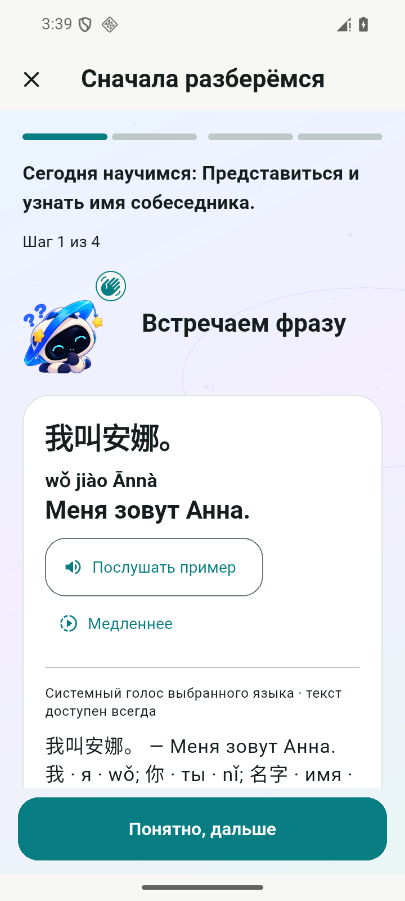
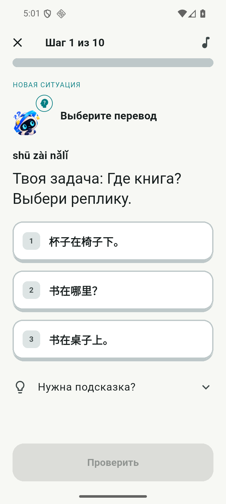
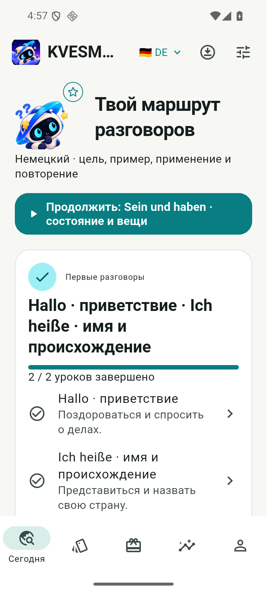
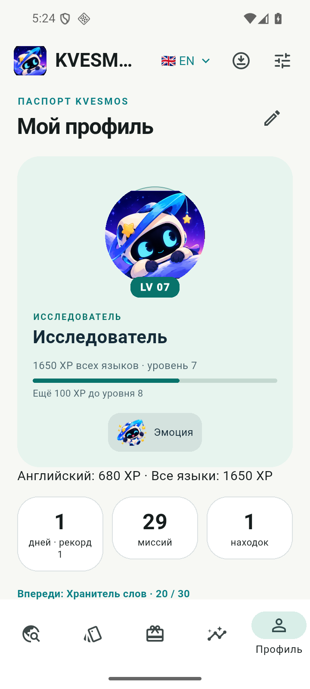
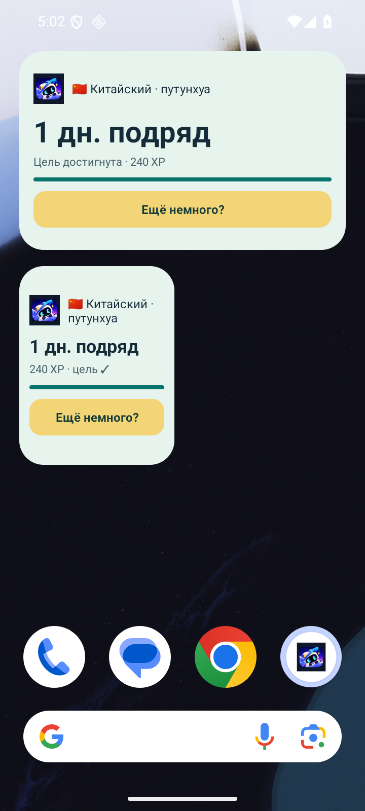

# KVESMOS 0.13 — Learning Revolution

Проверочная версия `0.13.0-dev.1+15`, ветка `codex/kvesmos-v013-learning-revolution`. База: PR #16, `codex/kvesmos-v012-five-languages-polish`, `1f74871b6f542dbd304299061377f62b1b3d6a24`. Изменения не объединяются в main.

## Учебный цикл

В приложении доступны 100 уроков: EN 40, ES 18, DE 18, FR 12, ZH 12. Добавлены 48 занятий (480 упражнений); старые 52 урока и начатые сессии сохраняют идентификаторы и материал. [Темы и редакторская проверка](CURRICULUM-0.13.md).

Карта теперь показывает мини-темы, цели, два связанных урока, справочник и контрольную точку с воспроизведением изученных реплик без вариантов. Доступ к следующему уроку определяется прежним прогрессом. Просмотр справочника ничего не начисляет. Галактика и три Space Adventures остались отдельными добровольными занятиями.

В практике шесть режимов: слова, аудирование, говорение с текстовым ответом, ошибки, диалоги и короткое повторение. Очереди и введённый текст сохраняются отдельно для курса и режима. Слова отбираются из уже встреченных, с приоритетом ошибок и сроков SM-2. Контрольная точка ограничена материалом своей темы. Все режимы используют существующие события повторения: один зачтённый успех на слово в день, без отдельной экономики. Новые повторные сессии завершённых уроков не дают XP и награды заново; исторические начисления не пересчитываются.

В обычных уроках используются диалоги с вопросом на понимание, аудиосигнал с доступным текстом, объяснённое исправление ошибки и карточка «прочитай — скрой — вспомни». Для китайского реплики и пиньинь разделены, чтобы чтение транскрипции не попадало в озвучку персонажа. Изменения оформления: крупные варианты с заметным выбранным состоянием, лёгкое основание плитки, плавная полоса прогресса, закреплённая кнопка проверки, реакция Орби и раскрываемая помощь. Сохранены собственные персонажи и цвета KVESMOS; новые иллюстрации не генерировались.

## Речь

512 локальных фраз в двух скоростях, 1024 AAC, 19 002 527 байт. Расширены EN/ES/DE, добавлена французская речь. Проверены хеши, декодирование, ненулевой сигнал, отсутствие цифровой перегрузки и более длинная медленная версия. Длительности 0,29–6,06 секунды. [Источники и ограничения](audio/VOICES-0.13.md).

Для путунхуа остаётся системный `zh-CN` и текст с пиньинем: у рассмотренного локального голоса не подтверждена лицензия датасета. Уроки доступны и без системного голоса. Оценка произношения и человеческое прослушивание всех синтетических файлов не заявляются.

## Проверки

- Полный локальный `flutter test --no-pub --concurrency=4`: **244 passed, 2 skipped**. Два пропуска относятся к ранее существовавшим необязательным сценариям.
- `flutter analyze --no-pub`: **No issues found**; Dart formatting выполнен.
- Все 100 уроков проверены на начисления и валидность данных; все 80 современных уроков и 20 прежних демонстрационных уроков пройдены через реальные Flutter-контролы.
- Новые экраны проверены при 390 px и 320 px / 200% текста, в светлой и тёмной теме. Проверены клавиатура, повторяющиеся плитки слов, отсутствие голоса, сохранение черновика и единый лимит повторений.
- Android API 36, обновление `install -r`: **13/13 событий, 4/4 сессии, 69/69 прежних настроек без изменений**, пакеты 52 → 100, прежние строки не удалены. Среди сессий сохранены незавершённые английский и китайский уроки. Исходная база и резервные копии остаются локально в `.tools/qa-v013`.
- На Android пройдены EN29, ES07, DE07, FR07, ZH07, включая обычную/медленную речь и текстовый fallback. Отдельный успешный нативный прогон завершил все шесть режимов практики, сундук/примерку, профиль, инвентарь, статистику и обе темы. Скриншоты виджета проверены для пяти языков. После найденной ошибки переключения курса добавлена проверка смены языка при открытой практике.
- Package ID `dev.orbitwords.orbitwords`, версия схемы БД и preview-сертификат сохранены. SHA-256 сертификата: `b8c558730dd20651119dd74b014b31ff51f076af208198dc79e05e51a0dca8be`.

## Демонстрация на Android

[Полный цикл нового урока](screenshots/v013/native-lesson-cycle.mp4) · [Сундук и примерка](screenshots/v013/native-chest-cycle.mp4). Это записи Android API 36, без наложенной графики; системный screenrecord не записывает звук.

| Урок 0.12 | Урок 0.13 |
|---|---|
|  |  |

Сравниваются реальные экраны разных упражнений: обновлены полоса прогресса и варианты ответа; в новом материале добавлены диалоги и активное воспроизведение.

| Темы | Практика | Виджет |
|---|---|---|
|  |  |  |

Проверочный ARM64 APK, хеш, сертификат и результат проверки находятся в локальном `build/releases`. Окончательные ссылки на GitHub Actions и артефакт приведены в Draft PR этой ветки. В репозиторий APK не добавляется.

## Границы проверки

Эмуляторные проверки не заменяют проверку на физических устройствах. iOS-сборка на Windows не выполнялась; код остаётся Flutter и не меняет идентификаторы платформ. Независимая редактура носителями пяти языков не проводилась. Синтетическая речь маркируется как синтетическая. Облачные аккаунты и данные пользователей не использовались.
