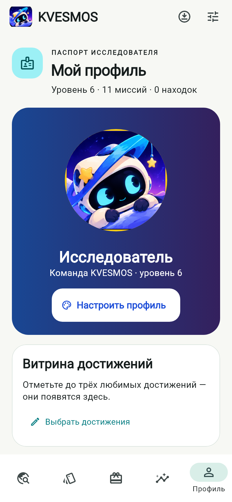
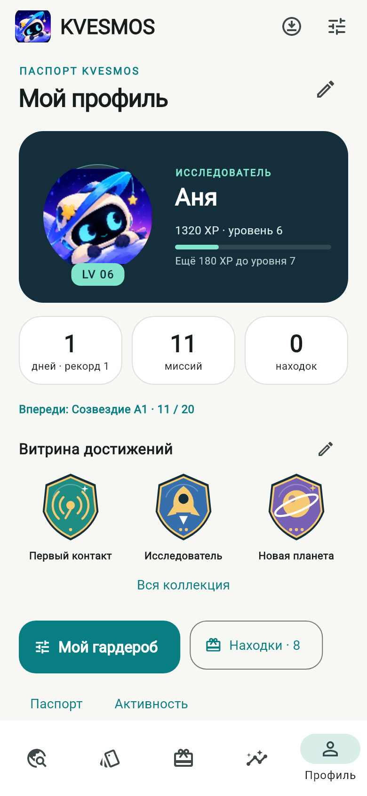
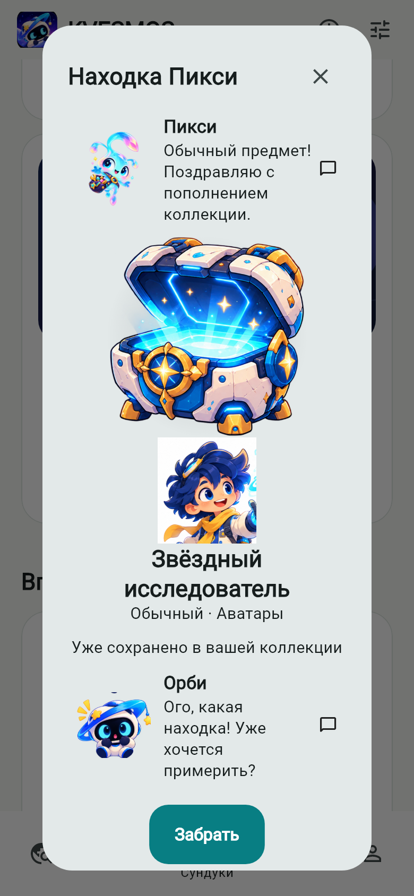
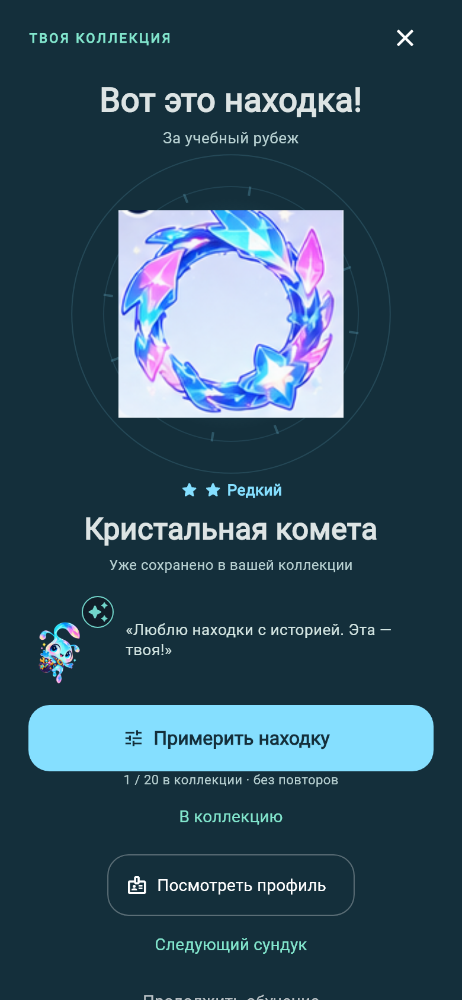
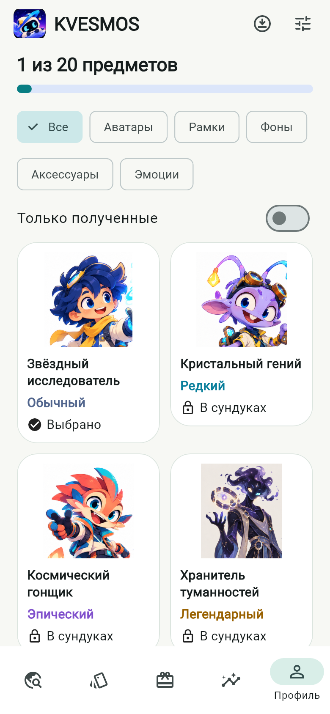
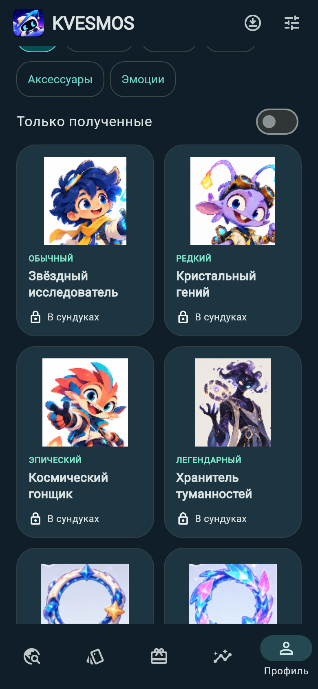

# KVESMOS 0.8 — Profile & Rewards Revolution

Версия `0.8.0-dev.1+10`, база — `00b86e4` / `feature/kvesmos-v07-learning-game`. Рабочая ветка `codex/kvesmos-v08-profile-rewards`; основная ветка и прежние PR не объединяются. Задание: [#7](https://github.com/1anchay/KVESMOS/issues/7).

## Что получает ученик

- Паспорт исследователя: одобренный Орби или выбранный аватар, имя с редактированием, уровень, XP до следующего уровня, серия и её рекорд, миссии, предметы, ближайший рубеж и три иллюстрированных избранных достижения. Основные сведения видны на первом экране 390 × 844. При 200% текст свободно переносится, страница прокручивается.
- Личные рекорды и активность за 7/30 дней вычисляются из существующих событий. Видны пять областей маршрута, даты достижений при наличии событий и честное пустое состояние. Облачные формы остаются ниже игрового профиля.
- Сундуки собраны в компактную сетку. Каждый открывается на отдельном экране: источник, реальные шансы, короткое ожидание, движение и смена закрытой/открытой позы, орбитальный свет, крупная находка, редкость словами и звёздами, реакция Пикси. Анимация открытия длится 1800 мс, её можно пропустить; при отключённых реакциях или системном уменьшении анимации предмет показывается сразу.
- Из находки можно сразу перейти к примерке, применить предмет, посмотреть изменившийся профиль, открыть следующий сундук или продолжить обучение. Уже открытый сундук просматривается спокойно.
- Гардероб: пять прежних слотов, все четыре редкости, полученные/закрытые/выбранные вещи, временная примерка, снятие предмета и сброс оформления без потери коллекции. Рамки отображаются кольцевой маской, чтобы непрозрачный центр исходного изображения не закрывал аватар. Исходные PNG не изменены.
- Шесть оригинальных векторных медалей с разными рисунками, ступенями, требованиями и прогрессом. Прежние названия, пороги и выбор трёх избранных сохранены. В завершении занятия появились иллюстрированные достижения с конечным появлением и настоящий рекорд дня, если существовал предыдущий учебный день и его результат превышен.
- Три новые короткие звуковые темы: экипировка (0,201 с), эпическая находка (0,542 с), легендарная (0,780 с). Прежние восемь файлов сохранены. Все 11 тем используют общий сервис, настройки громкости и защиту от наложения на учебную речь.

Аксессуары и эмоции — **слоты карточки профиля**, не одежда на теле персонажа. Для настоящей послойной экипировки нужны отдельные прозрачные слои, якоря и позы. Смена поз сундука использует готовые закрытое/открытое изображения; скелетной анимации отдельной крышки в исходных ресурсах нет. Новые растровые изображения не генерировались.

## Данные и отказоустойчивость

`Inventory` остаётся JSON `version:1` в `kvesmos.inventory.v1`. ID выдач, распределение вероятностей, уникальность предметов, существующие квесты и экспедиции не меняются. `openOnce` возвращает признак новой выдачи **из той же транзакции**, поэтому конкурентный вызов получает прежний предмет и не запускает повторное празднование. Запись предшествует анимации. Закрытая сцена не отменяет уже начатую запись; повторное открытие читает актуальное состояние.

Примерка не меняет владение или экипировку. Изменения публикуются после успешной атомарной записи; при ошибке примерка возвращает прежнее оформление и предлагает повторить действие. Сброс очищает только карту экипировки в одной транзакции. Имя также публикуется после сохранения. Нового кошелька, покупок, рекламы, таймеров давления или дополнительных XP нет.

`ExplorerRecords` — вычисляемая проекция журнала событий, без новой таблицы или миграции. Она использует те же правила устранения повторов, что и XP. Настройки витрины остаются локальными и не превращаются в события синхронизации.

## Реальные Flutter-экраны

Снимки сделаны с производственных виджетов, не с макетов. Для сравнения профиля использовано 11 завершённых уроков; в новом профиле тестовый пользователь выбрал имя Аня и три избранных значка. Эти настройки не применяются пользователям автоматически.

| До, версия 0.7 | После, версия 0.8 |
|---|---|
|  |  |
|  |  |
|  |  |

[Готовый сундук](screenshots/v08/chest-ready-light.png) · [Примерка](screenshots/v08/try-on-light.png) · [Изменившийся профиль](screenshots/v08/profile-equipped-light.png) · [Достижения](screenshots/v08/achievements-light.png) · [Рекорды](screenshots/v08/records-light.png).

[Обычная](screenshots/v08/reveal-common.png), [редкая](screenshots/v08/rare-reveal-light.png), [эпическая](screenshots/v08/reveal-epic.png) и [легендарная](screenshots/v08/reveal-legendary.png) находки. Редкость в тестах фиксируется только через переданный QA-генератор; в приложении по умолчанию остаётся `Random.secure()` и исходные шансы.

[Тёмная тема](screenshots/v08/profile-equipped-dark.png) · [Новый профиль](screenshots/v08/empty-profile-light.png) · [Нет сундуков](screenshots/v08/empty-rewards-light.png) · [Закрытые достижения](screenshots/v08/empty-achievements-dark.png) · [320 px / 200%](screenshots/v08/profile-light-320-200.png) · [Примерка 320 px / 200%](screenshots/v08/try-on-light-320-200.png).

**[Демонстрация: награда → примерка → профиль → достижение → карта](screenshots/v08/reward-to-profile.mp4)** — 22 секунды, 390 × 844, 10 кадров/с. Это запись реального Flutter-рендеринга без звука и системной клавиатуры. Перед записью тест действительно проходит первый урок через учебные кнопки, получает 120 XP и три прежние награды. Видео начинается с завершения урока. Это не запись физического телефона и не измерение частоты кадров.

## Проверки и воспроизведение

```powershell
dart format --output=none --set-exit-if-changed lib test integration_test
flutter analyze
flutter test
$env:CAPTURE_UI='1'; flutter test test/collection_screens_test.dart test/rarity_screens_test.dart
$env:CAPTURE_COLLECTION_DEMO='1'; flutter test test/collection_demo_test.dart
flutter test integration_test/alive_journey_test.dart -d emulator-5554
```

Новые проверки покрывают даты и рекорды, повторные события, конкурентное открытие, закрытие до завершения записи, отказ записи и повтор, полностью собранную коллекцию, отсутствующую картинку, атомарный сброс, семантическую подпись предмета, четыре редкости, обе темы, крупный шрифт, примерку и переход к следующей миссии. Существующие тесты сохранности SQLite, старого инвентаря, экипировки, витрины, квестов, черновиков и всех двадцати уроков сохранены. Два теста записи видео запускаются отдельно по переменным окружения.

## Обновление и измерения

На отдельном `OrbitWords_QA`, Android API 36 x86_64, приложение обновлено командой `install -r` с версии 9 на 10 после проверки подписи и резервной копии. Сравнение после первого запуска: все 10 прежних строк настроек, 20 пакетов уроков, 3 сессии и 13 событий остались побайтно равны. Схема SQLite остаётся 1. Package — `dev.orbitwords.orbitwords`. Сертификат SHA-256 — `b8c558730dd20651119dd74b014b31ff51f076af208198dc79e05e51a0dca8be`.

| Измерение | 0.7 | 0.8 |
|---|---:|---:|
| Android Activity: медиана 5 запусков после прогрева | 4844 мс | 4180 мс |
| PSS после последнего запуска | 345 786 KiB | 346 587 KiB |
| Звуковые эффекты | 8 | 11 |
| Речевые файлы | 220 | 220 |

Одинаковый QA-эмулятор, debug x64, host GPU, Vulkan выключен, 2 ядра / 2048 MB, 720 × 1600 при 320 dpi. Замер запуска — **не** Flutter first meaningful paint; разница не доказывает ускорение. Рост PSS менее 1 MiB на этой выборке. Нативный сценарий отдельно собирает Flutter FrameTiming открытия сундука; debug-эмулятор не заменяет профилирование release-сборки на телефоне. Итоговые нативные результаты, размер и хеш проверенного ARM64 APK и GitHub Actions фиксируются в Draft PR и отчёте сборки.

## Границы проверки

Физический Android, iOS на macOS, полный ручной TalkBack/VoiceOver-аудит и слуховая оценка на реальных динамиках остаются отдельными проверками. Нативный QA-эмулятор проверяет выполнение аудиоканала, но видеозапись без звука. Готовые изображения местами имеют ограниченное разрешение и непрозрачные фоны; для настоящей одежды и более детальной анимации нужны дополнительные согласованные ресурсы.

В решениях использованы общие принципы [коллекционных достижений](https://blog.duolingo.com/achievement-badges/), [коротких наградных моментов](https://blog.duolingo.com/product-highlights/) и [предметов для аватара](https://blog.duolingo.com/october-2026-update/). Рисунки, названия, звуки, палитра и композиция KVESMOS оригинальны. Эти ссылки не являются утверждением об эффективности конкретной реализации.
