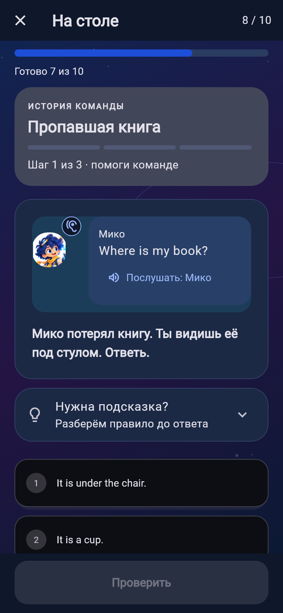
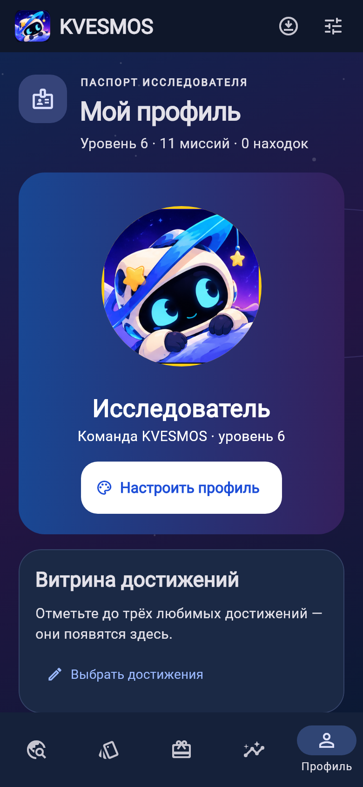
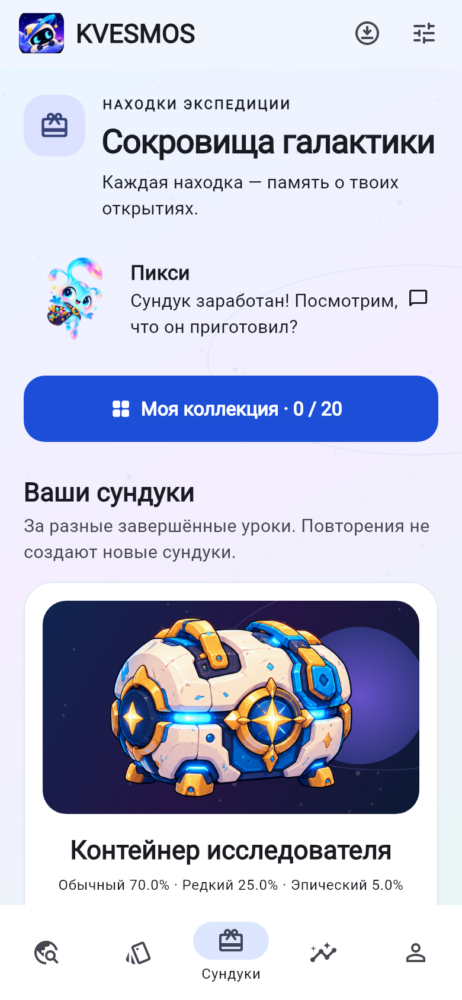
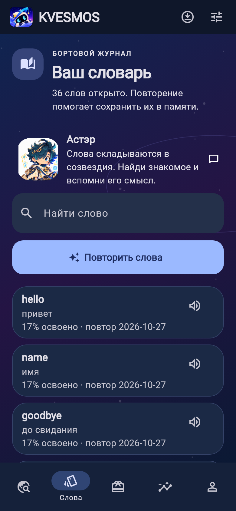
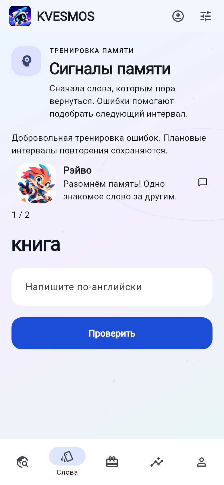

# KVESMOS 0.5.0-dev.1+7

Рабочая ветка `feature/kvesmos-v05-quality` создана от проверенного `5e72e115abd8f584449b956f7e617e06341520e9` ветки 0.4.0. PR 1 ещё не объединён: новый PR направляется в его ветку, main не изменяется.

## Что изменилось

- Главная: текущая учебная цель, Орби и интерактивное созвездие всех 20 миссий. Сохранена подробная карта миров и прежние правила доступа.
- Урок: карточки выбора, постоянная нижняя кнопка проверки, адаптация к клавиатуре, короткий статус ответа. Мини-истории имеют отдельный индикатор шага; пустая реплика ученика убрана.
- Завершение: праздничный Орби, заработанные XP, освоенный навык, точность всех попыток, слова для повторения и прежние награды.
- Профиль, словарь, повторение и сундуки: общая космическая палитра в двух темах, новые заголовки и сцены наград. Открытие сундука дополнено конечной вспышкой. Инвентарь, коллекции, достижения и настройки оформления сохранены.
- Готовая графика KVESMOS сохранена. Новые фоны, созвездие и выражения лица рисуются Flutter Canvas; генерация растровых изображений не использовалась.

## Обучение

Оставшиеся 14 уроков (7–20) получили авторские материалы версии 3: три объясняющих шага и десять упражнений с переходом от знакомства к самостоятельной реплике. Первые шесть переработанных уроков сохранены. Всего 20 вводных уроков / 200 упражнений / 60 словарных ID. Это стартовая экспедиция, не полный объём CEFR A1.

Пять законченных линейных мини-историй по три интерактивных шага: семейный альбом, пропавшая книга, покупка билетов, городской маршрут и подарок. Верный ответ появляется в разговоре; ошибка получает обычное объяснение и повторную попытку. Шаг и черновик сохраняются тем же механизмом сессий. Это не разветвлённые сюжетные кампании.

[Карта навыков](A1-SKILLS.md) и `assets/courses/skills.json` описывают предпосылки и результаты каждого урока. Проверяются порядок навыков и слов, разнообразие типов, повторы и самостоятельное последнее задание. Редакторский источник: `tool/author_a1_v05.py`. Все прежние ID уроков/слов, XP, SM-2 и закреплённые материалы начатых сессий сохраняются. Незавершённый старый урок можно продолжить в его прежней версии.

## Персонажи и звук

Орби получил независимые программные глаза, зрачки, моргание, улыбку и формы рта поверх исходной позы. Касание вызывает приветствие/удивление и движение взгляда. Мико, Зиг, Орби и Нокс имеют разные темп, наклон и амплитуду движения. Движения конечные; системное уменьшение анимации и настройка реакций учитываются. Мико и Зиг пока остаются цельными портретами; нет полного рига тела или фонемного lip-sync.

Офлайн-пакет: **94 английские реплики, 188 AAC/M4A-файлов, 3 856 074 байта**, три опубликованных синтетических стиля Kokoro: Орби `af_heart`, Мико `am_michael`, Зиг `am_puck`. Студийных исполнителей — **0**. Модели в приложение не входят; синтез выполнен заранее локально. [Лицензии, источники и воспроизводимость](audio/KOKORO-PROVENANCE.md).

Поддерживаются обычная и отдельно синтезированная медленная версия, повтор, громкость, остановка, пауза/продолжение локальной записи. Индикатор различает подготовленную речь и системный TTS. Русские подсказки, другие герои и отсутствующие фразы используют системный резерв; без движка остаются текст и возможность продолжить урок. Тестирование декодирования не заменяет редакторское прослушивание всех реплик.

## Проверки и совместимость

- Локально: **98 тестов успешно**, включая прохождение всех 200 упражнений через интерфейс; `dart analyze lib test integration_test/voice_pack_smoke_test.dart` без замечаний, форматирование 61 файла без изменений. Android debug x86_64 собран; нативный тест аудио также прошёл.

- Исходная база schema 1, Android package `dev.orbitwords.orbitwords` и iOS bundle ID сохранены. Версия Android повышена с 6 до 7.
- На выделенном Android API 36 x86_64 эмуляторе обновление 0.4.0-dev.3 → 0.5.0-dev.1 через `install_preview.py` создало частную резервную копию и выполнило только `install -r`. Сравнение всех строк SQLite: 6 настроек, 20 пакетов, 3 сессии, 13 событий сохранены без изменений. В фикстуре есть XP, ошибка, награда и незавершённая сессия с черновиком.
- Прежний SHA-256 сертификата: `b8c558730dd20651119dd74b014b31ff51f076af208198dc79e05e51a0dca8be`. Ключ не менялся и не включён в репозиторий.
- Все 188 файлов прошли SHA-256, полное AAC-декодирование, проверку ненулевого сигнала и отсутствия клиппинга; длительности 0,73–4,57 с. Все медленные версии длиннее обычных (`tool/verify_voice_pack.py`).
- Нативный Android smoke-тест: каждый из трёх голосов запускается, приостанавливается, продолжается, сообщает завершение; медленная версия запускается и отменяется без устаревшего состояния.
- **Flutter integration runner может переустановить/очистить тестовое приложение.** Его запускали только на выделенном эмуляторе. После проверки возвращены основная сборка и резервная копия синтетических данных. Никогда не запускать этот тест на телефоне пользователя; для обычного обновления использовать безопасный установщик.
- Снимки семи экранов в светлой/тёмной теме проверены визуально. Те же экраны проверяются при ширине 320 px и масштабе 200%; уроки дополнительно проходят через реальные кнопки. Снимки ниже получены из настоящих Flutter-виджетов на изолированной заполненной базе, не из макетов.
- Физический Android-телефон и сборка iOS в этой Windows-среде не проверялись. Полный аудит TalkBack/VoiceOver и человеческая оценка дикции остаются перед публичным выпуском.

## Скриншоты

| Главная | Мини-история |
|---|---|
|  |  |

| Результат | Профиль |
|---|---|
|  |  |

| Сундуки | Словарь | Повторение |
|---|---|---|
|  |  |  |
