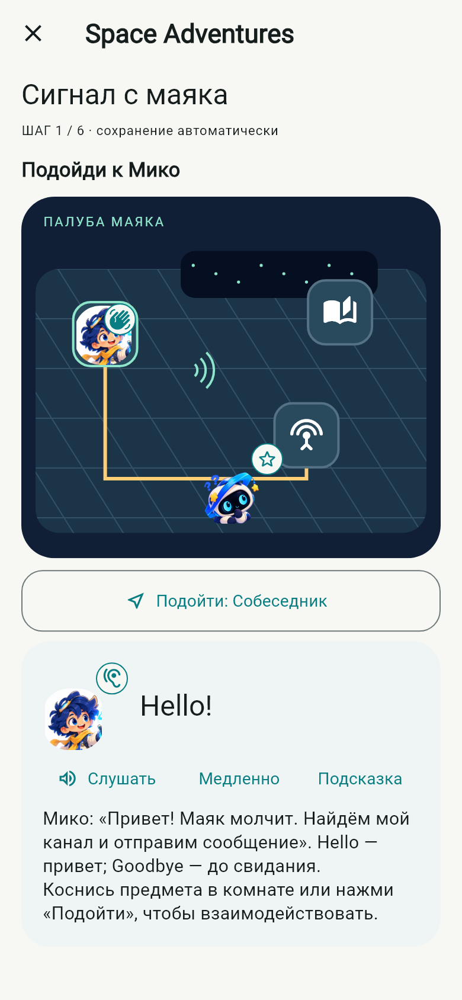
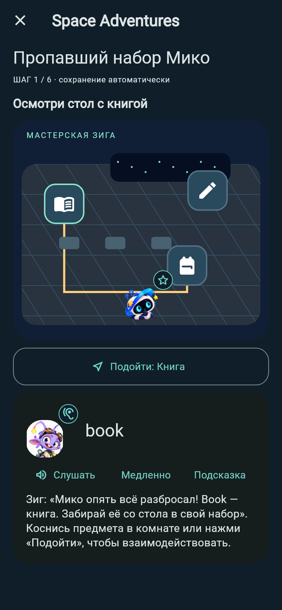
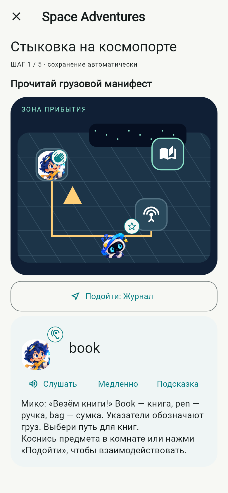
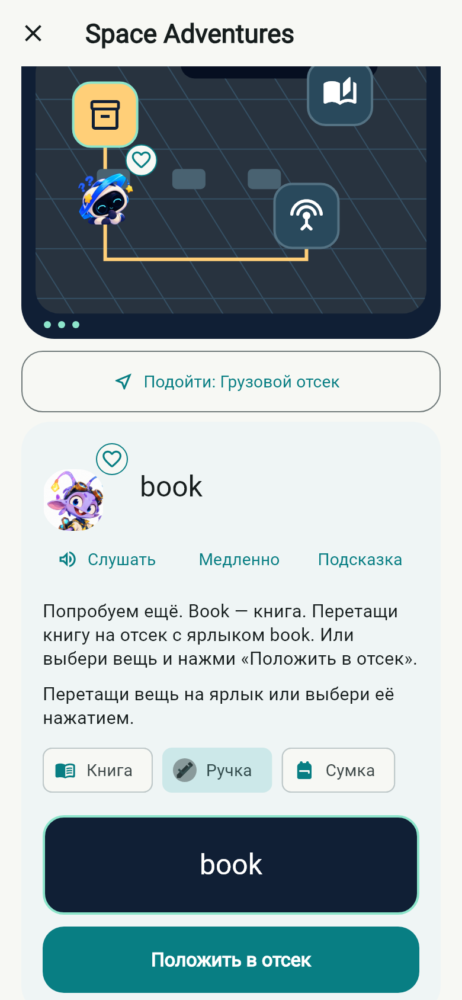
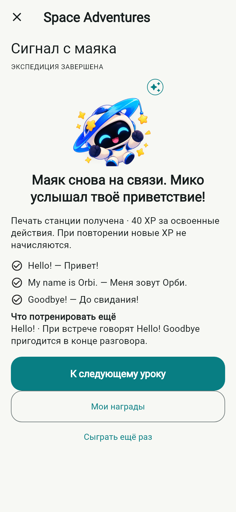

# KVESMOS 0.9 — Space Adventures

База: `codex/kvesmos-v08-profile-rewards`, `0aa84671337044613448331bd4b2a24ae6cdd5db` (PR #8). Задание: [Issue #9](https://github.com/1anchay/KVESMOS/issues/9).

## Что можно пройти

| Приключение | Разблокировка | Действия | Первые решения |
| --- | --- | --- | --- |
| Сигнал с маяка | «Первый контакт» | Подойти к Мико, поздороваться, изучить журнал, настроить канал, собрать и отправить сообщение, завершить связь | 40 XP |
| Пропавший набор Мико | Уроки 1 и 3 | Найти и взять книгу, ручку и сумку; рассортировать вещи по английским ярлыкам | 30 XP |
| Стыковка на космопорте | Уроки 3 и 5 | Прочитать манифест, выбрать грузовой маршрут, изучить терминалы, направить корабль по услышанному номеру, открыть шлюз | 30 XP |

Каждая сцена — небольшой интерактивный план помещения: касания перемещают Орби, предметы открывают действия. «Подойти» даёт эквивалент для экранного диктора. Сортировка поддерживает перетаскивание и выбор вещи с подтверждением; радиосигнал собирается из перемещаемых в сообщение слов. Нет таймеров, жизней, штрафов, обязательного микрофона, клавиатуры или сетевого запроса.

Маяк, мастерская и космопорт находятся после соответствующих уроков на существующей карте. Пройденная станция отмечается печатью и остаётся доступна для повторения. На карте появляется короткая цель дня; завершения за сегодня вычисляются из событий, отдельного ежедневного журнала наград нет. Существующие уроки и восемь диалоговых историй сохранены.

## Реальные экраны и взаимодействия

[Демонстрация трёх приключений, 47 секунд, без звука](screenshots/v09/space-adventures.mp4). Это захват реальных Flutter-виджетов, управляемых tap/drag тестом; не запись физического телефона. QA-профиль предварительно прошёл пять уроков через учебный репозиторий. Экранные действия, ошибочные ответы, возвращение в сохранённую сцену и сортировка выполняются через интерфейс.

Полная матрица снимков: [светлая тема](screenshots/v09/), [маленький экран и 200% текст](screenshots/v09/port-light-320-200.png). На увеличенном тексте используется вертикальная прокрутка без обрезки инструкций; заголовок панели приложения сокращается стандартным многоточием.

## Сохранение и экономика

- SQLite остаётся v1. Новые записи `kvesmos.adventure.v1:<id>` в Settings содержат версию, шаг/комнату, координаты, выбранный объект, предметы, собранные слова, решённые действия, ошибки, подсказку и последнюю реплику.
- Действие и учебное событие фиксируются одной транзакцией до показа результата. `revision` защищает от двойного нажатия и второй открытой сцены. Неизвестная версия сохранения не перезаписывается.
- Первое правильное решение создаёт стабильное событие `answer`, используя прежние 10 XP и SM-2. Ошибки до первого решения учитываются без штрафа XP. Повторный проход не создаёт новых учебных событий и не улучшает мастерство искусственно; дальнейшее повторение слов доступно в существующей практике.
- Завершение имеет стабильный `adventure_complete` ID и не выдаёт дополнительный бонус. Сундуки выдаются прежними правилами ежедневных заданий и этапов; прямой выдачи сундука за каждый запуск сцены нет.
- Идентификатор `dev.orbitwords.orbitwords`, ключ подписи, старые пакеты, сессии, инвентарь и схема не меняются. Версия `0.9.0-dev.1+11`.

## Ассеты и производительность

Новых растровых изображений и игровых зависимостей нет. Помещения нарисованы простым `CustomPainter`; персонажи используют утверждённые изображения. Перемещение и реакции конечные, постоянного игрового цикла нет. Уважены отключённые анимации и существующие настройки звука.

Добавлены три коротких оригинальных сигнала (`interact`, `pickup`, `chapter`) и семь английских реплик Kokoro в обычном и медленном темпе: 14 AAC-файлов. Все 220 прежних голосовых файлов сохранены. Пакет теперь содержит 117 реплик / 234 файла; контрольные суммы и декодирование проверены (`tool/verify_voice_pack.py`). Это синтетические голоса, не актёрская озвучка. При выключенном аудио или ошибке плеера текст и действия остаются доступны.

## Проверки

- `space_adventures_test.dart`: все три сценария, сохранение координат/инвентаря/реплики, ошибочные попытки, конкурентные нажатия, откат записи и XP при сбое SQLite, повтор в другой день, сохранность старых событий и черновика, неизвестная версия.
- `space_adventure_widgets_test.dart`: все сценарии через реальные нажатия, сортировка через drag и кнопки, неверный ответ, подсказка, выключенный звук, уход со сцены/возврат, светлая/тёмная тема, 390 px и 320 px / 200%, отключённые реакции.
- `integration_test/space_adventures_test.dart`: первый урок → разблокировка → три приключения → повтор без XP → сундук → профиль → карта; проверка нативного проигрывателя и FrameTiming. Запускать исключительно на отдельном QA-эмуляторе, предварительно сохранив его данные.
- При обновлении установленного QA-профиля с 0.8 через `adb install -r` сохранены все прежние строки: 10 настроек, 20 пакетов, 3 сессии, 13 событий; изменённых/пропавших строк — 0. Схема v1 и сертификат совпали. Проверка относится к синтетическому профилю эмулятора.

Нативный сценарий прошёл за 2:41 на отдельном Android API 36 x86_64 эмуляторе с отключёнными Wi-Fi и мобильными данными. Пройден первый урок через интерфейс, затем три станции; первая повторена без XP. Проверены открытие сундука, профиль, возврат на карту, нативное воспроизведение всех учебных реплик и трёх новых эффектов. После прогона добавлено только уточнение доступности: декоративные портреты на сцене исключены из семантики; управление повторно проверено widget-тестом.

Обычная production-точка входа `lib/main.dart` также проверена: процесс закрыт через 0,235 с после Hello; в SQLite остался шаг 3/6, одно новое событие и прежний инвентарь. После повторного входа на станцию состояние совпало целиком, повторного события нет. [Реальный Android-экран после восстановления](screenshots/v09/native-resumed.png). Числа и условия прогона — [v09-android.json](verification/v09-android.json).

Полный локальный набор: 129 успешных тестов, 2 необязательных capture-теста пропущены; новый 47-секундный capture запускался отдельно. Форматирование и анализ успешны. Итоговые ссылки CI и проверенный ARM64 APK публикуются в [Draft PR #10](https://github.com/1anchay/KVESMOS/pull/10) и отчёте сборки.

Добавлено 188 275 байт аудио, без новых изображений или зависимостей. На debug x64 эмуляторе после восстановления PSS = 348 798 KiB. В нативном интерактивном тесте 682 FrameTiming: build median/p95 = 2,005/29,179 ms, raster = 2,316/6,109 ms. Это отладочный сценарий с прокруткой и тестовым драйвером, не измерение release FPS; p95 build превышает бюджет 16,7 ms.

## Границы реализации

Три короткие линейные станции, а не открытый мир и не 20 приключений. Перемещение — между точками на плане без физики, столкновений и скелетной анимации. Длительность зависит от чтения/прослушивания; быстрое прохождение возможно быстрее двух минут. Русские объяснения текстовые; английские учебные реплики озвучены. Данные приключений локальные; учебные события используют прежнюю синхронизацию. Физические Android-устройства, iOS, TalkBack/VoiceOver и субъективная оценка звука на настоящем динамике требуют отдельной проверки.
